# Vandring med kompisar

En länge planerad vandring med polarna till Helvetinjärvi nationalpark blev slutligen av. Trots att vi redan är i oktober var vädret så pass bra att jag beslutade mig för att åka mc till vandringen. Vi samlades på fredag eftermiddag, men tyvärr hade kompisarna annat program från lördag kväll. Själv beslöt jag mig för att fortsätta färden till Liesjärvi nationalpark för en andra övernattning. Samtidigt fanns det möjlighet att besöka några nya kommuner.

<!--more-->

Att ta sig till ett vandringsmål med mc skapar vissa logistiska utmaningar. En vandringsryggsäck är stor och otymplig att packa på hojen. Vidare behöver man dels utrustning för vandringen och dels utrustning för körningen – väldigt få prylar passar för båda. Nu hade vi i och för sig inte planerat någon särskilt avancerad vandring; tältplatserna låg bara drygt en kilometer från parkeringen. Det skulle ha varit möjligt att bära sadelväskorna – fast ganska kämpigt. För utmaningens skull tänkte jag försöka få med hela vandringsutrustningen. Och det lyckades sist och slutligen rätt bra. En fullpackad vandringsryggsäck rymdes i min stora vattentäta drybag, bara jag tog bort tältet.

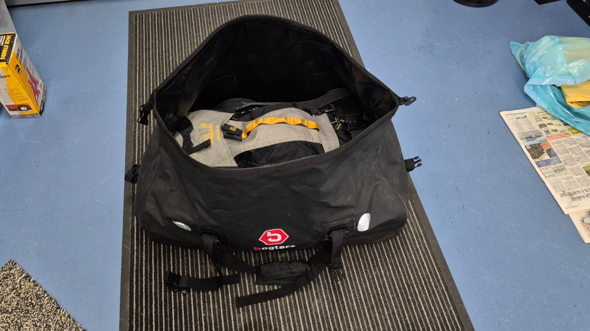

Tältet fick i stället åka i en av sadelväskorna. Den extra utrustningen för körningen, såsom fleece, regnställ och extra handskar, rymdes också i sadelväskorna, liksom en presenning till Lilla Blue. Den enda kompromissen jag blev tvungen att göra var att lämna de stora vandringskängorna hemma och i stället ta ett par låga terränglöpningsskor. Skorna funkade fint på den här resan, men i grövre terräng kan det bli ett problem. För dagsutfärder funkar tankväskan bra, precis som på mina andra resor.

## På väg mot Helvetinjärvi nationalpark

Nästan allt var packat på torsdag kväll. Jag tog en kortare arbetsdag på fredag, packade kylvarorna i sidoväskorna och åkte i väg.

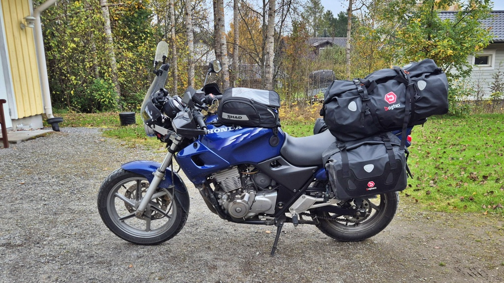

Väderleksrapporten hade lovat en torr dag med lite sol – i praktiken var det tjocka moln och till och från lite duggregn. Men det var varmt, så det var inget problem att köra. Jag tankade i Kurikka och passade sedan på att fota några kyrkor jag åkte förbi: Kurikka, Jalasjärvi och Virdois (fi: Virrat).

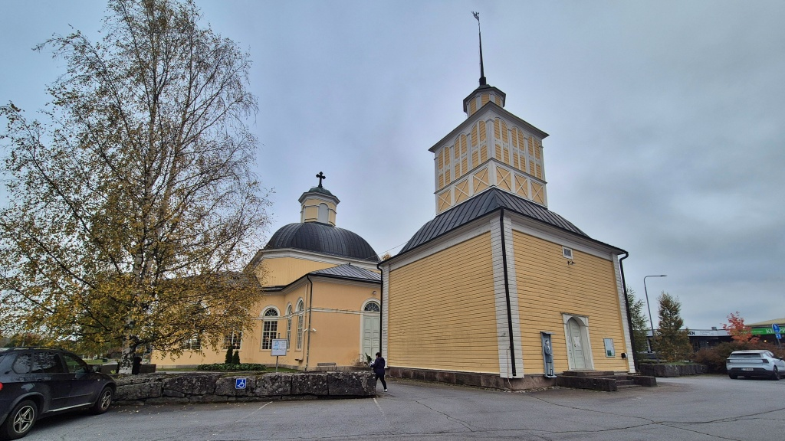

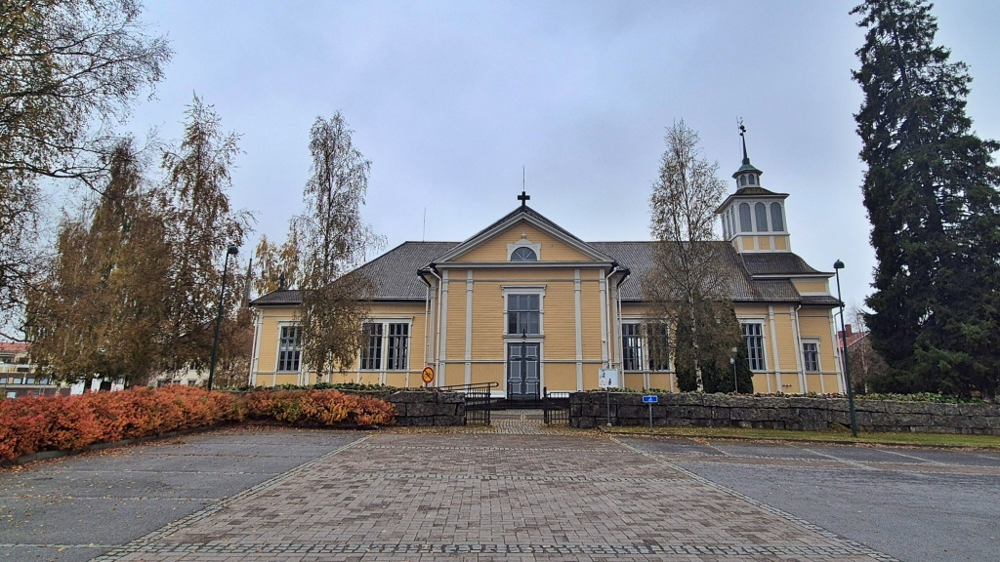

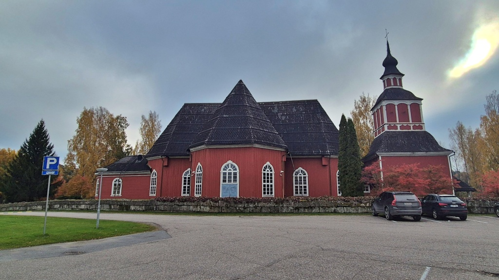

Söder om Virdois ligger Torisevas ravinsjöar. Jag tog en kort paus vid kaffestugan. Kaffestugan var stängd för säsongen, men jag beundrade utsikten och hittade faktiskt en bunt gula kantareller som jag plockade med mig.

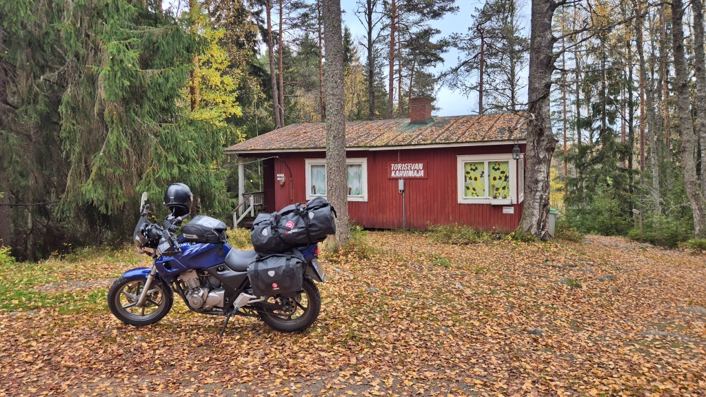

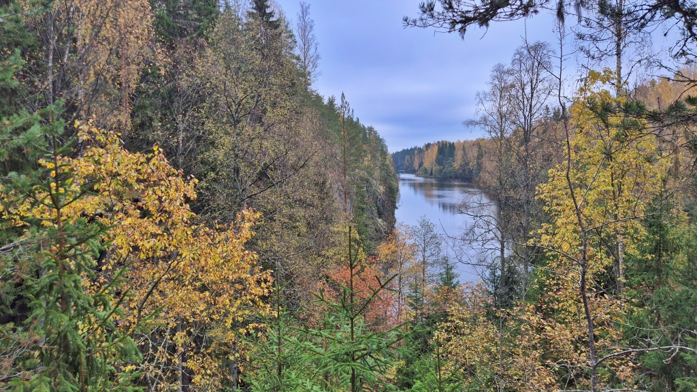

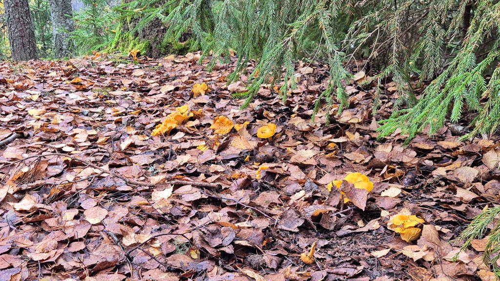

Jag körde också in i Visuvesi, mest för det roliga namnets skull. Nere vid vattnet, mitt i ett industriområde, ligger byns badstrand och ett litet kapell nere vid vattnet, Kulkurin Kappeli.

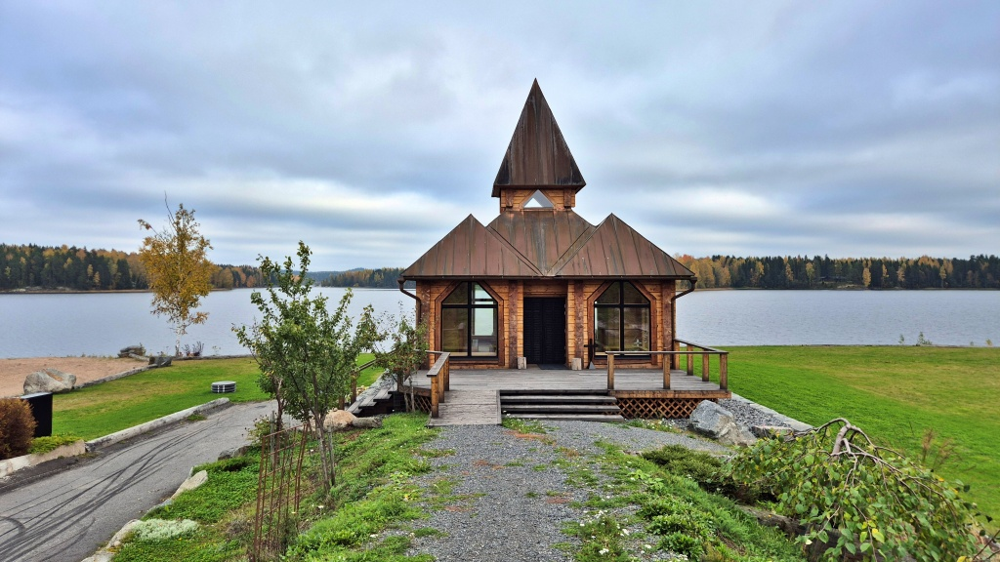

Sedan åkte jag via Ruovesi och provianterade lite innan jag gav mig av på de långa grusvägarna mot tältplatsen Haukanhieta i [Helvetinjärvi nationalpark](https://www.luontoon.fi/sv/destinationer/helvetinjarvi-nationalpark). I Ruovesi kikade faktiskt solen fram, men så snart vi vände mot nordväst försvann den igen bakom tjocka moln.

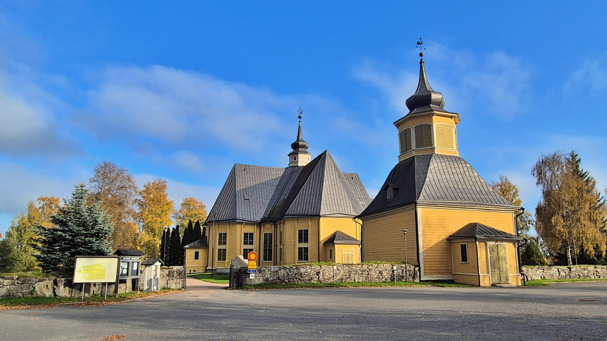

## Helvetinjärvi nationalpark

Vid parkeringsplatsen träffade jag mina kompisar. Vi slog upp våra tält på stranden, lagade lite mat och satt och pratade. På lördag gjorde vi vår dagsvandring till Helvetinkolu och tillbaka. Vädret var grått och trist, med duggregn mest hela tiden, men landskapet är vackert och humöret var på topp.

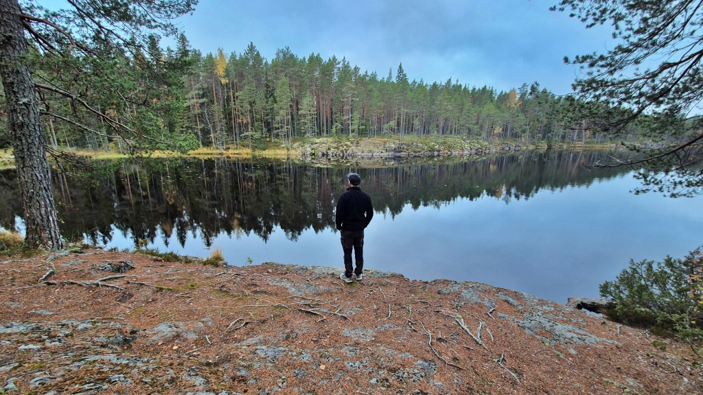

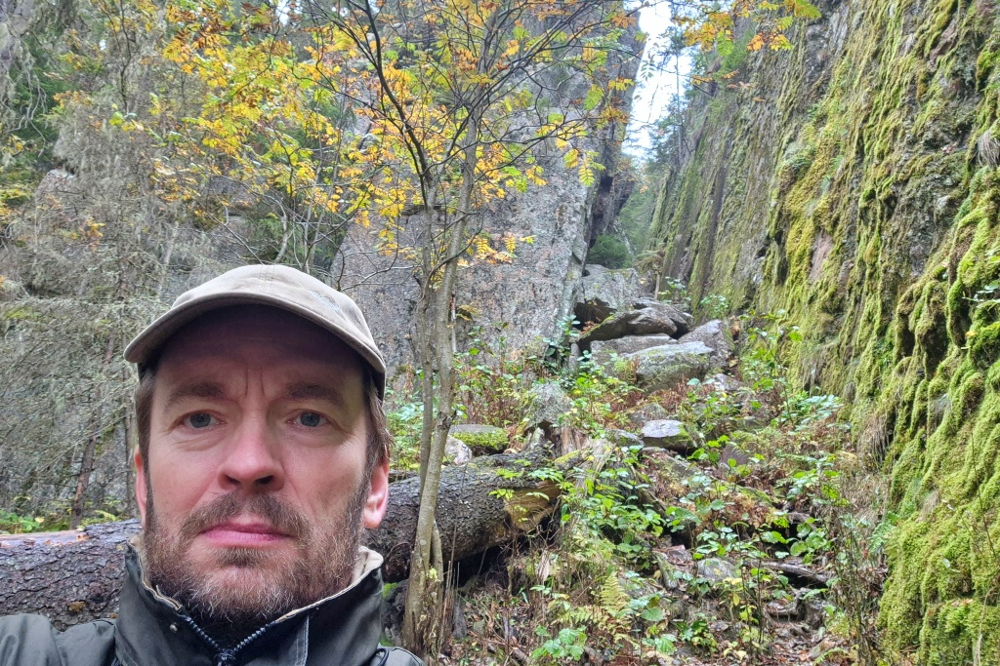

Tyvärr hade mina kompisar annat program på lördag kväll, så när vi kom tillbaka från vår vandring till Helvetinkolu skildes vi åt och var och en for åt sitt håll.

## På väg mot Liesjärvi

Jag hade redan planerat att fortsätta, men hade egentligen två alternativ. Det kortare alternativet hade varit Kauhaneva nationalpark på gränsen mellan Kauhajoki och Storå. Det hade inneburit en kort resa på lördagen, en lagom lång stig att gå på söndagen och en kort resa hem. Det andra alternativet var betydligt längre: till Liesjärvi nationalpark i Tammela. Eftersom det redan var eftermiddag skulle det vara omöjligt att hinna till Liesjärvi innan det blev mörkt. Vädret var dessutom fortsatt ostadigt med duggregn och tjocka moln, och utsikterna för söndagen var ännu våtare. Alltså borde väl det första alternativet ha varit givet, men på något konstigt sätt blev det ändå så att jag styrde söderut mot Tammela.

Eftersom det stod klart att dagsljuset inte skulle räcka kortade jag rutten en del. Dagens viktigaste delmål var Högfors (fi: Karkkila), en ort som jag inte tidigare besökt med Lilla Blue. Jag kunde ändå inte förmå mig att ta den snabbaste rutten, via Tammerfors motorväg ner till Riihimäki och sedan via Loppis till Högfors. I stället valde jag en betydligt roligare, östligare rutt längs vägar jag inte tidigare åkt.

Rutten gick via Orivesi, Eräjärvi (tidigare kommun, del av Orivesi sedan 1973), Kuhmalahti (förut Kuhmalax på svenska, tidigare kommun, del av Kangasala sedan 2011), Luopiois (fi: Luopioinen, tidigare kommun, del av Pälkäne sedan 2007) och Hauho (tidigare kommun, del av Tavastehus sedan 2009). Vägarna var nog ställvis riktigt mc-vänliga, men samtidigt gnagde hela tiden oron för att timmarna med dagsljus höll på att ta slut. Det duggade nästan hela tiden och molnen var så tjocka att det kändes som skymning fast solen ännu var uppe. Dessutom är något fel på drivpaketet, antagligen en styv länk i kedjan. Det rasslar fruktansvärt, så resan var inte någon större njutning.

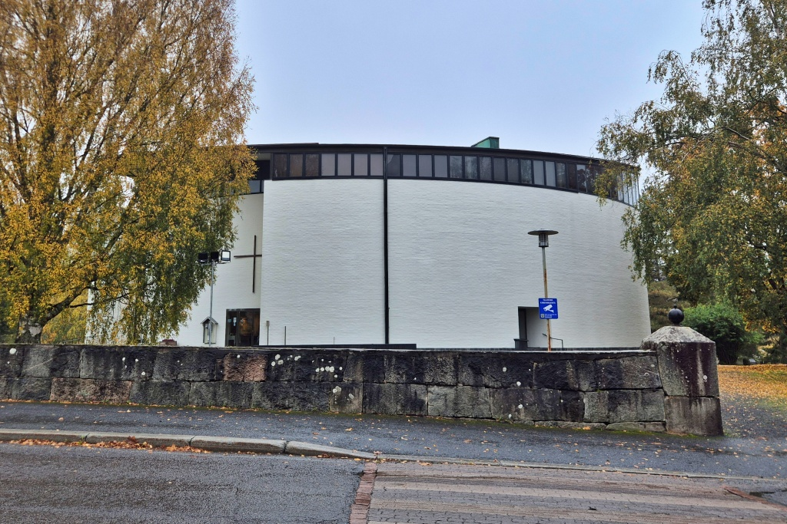

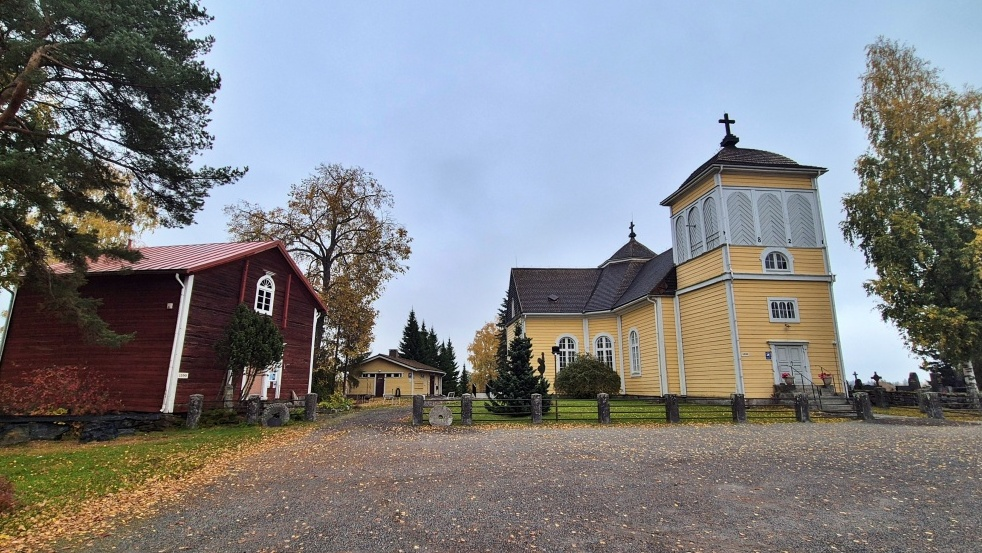

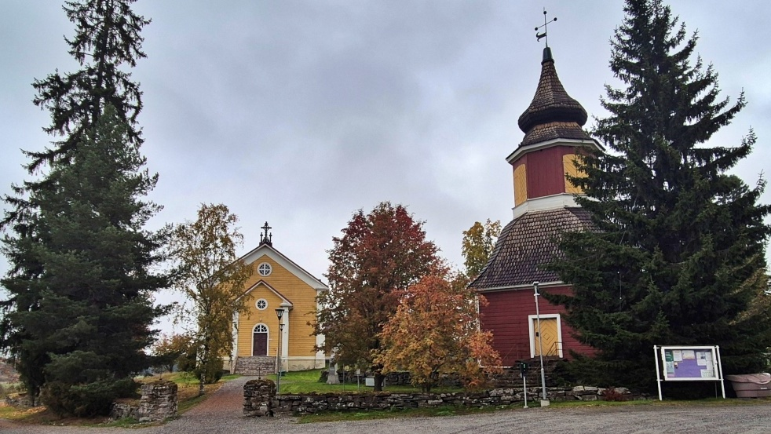

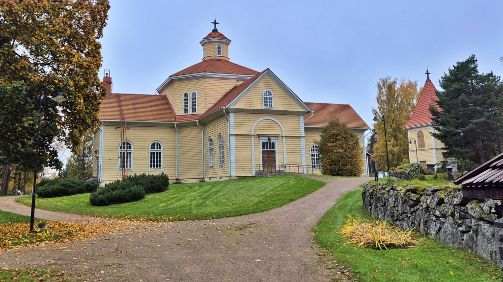

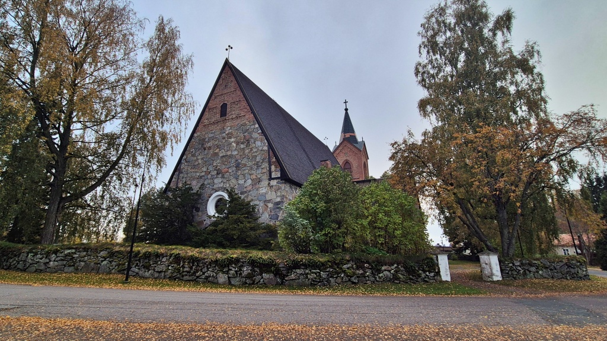

I Tavastehus tankade jag och drog på mig min fleece, för det började bli svalt. Sedan blev det en kort bit motorväg och stora vägen i riktning mot Åbo. I Renko (tidigare kommun, del av Tavastehus sedan 2009) svängde jag åter in på smalare vägar. Inne i byn Renko höll jag nästan på att krocka med en hjort som tydligen höll på att käka upp någons bärbuskar. Det gick inte särskilt snabbt, men visst blev jag lite skärrad.

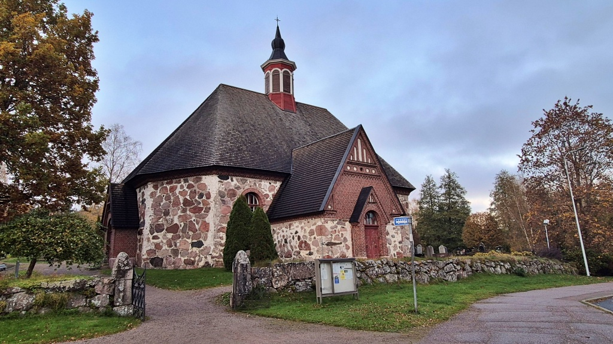

I Loppis hade molntäcket spruckit upp, men nu började det skymma på riktigt.

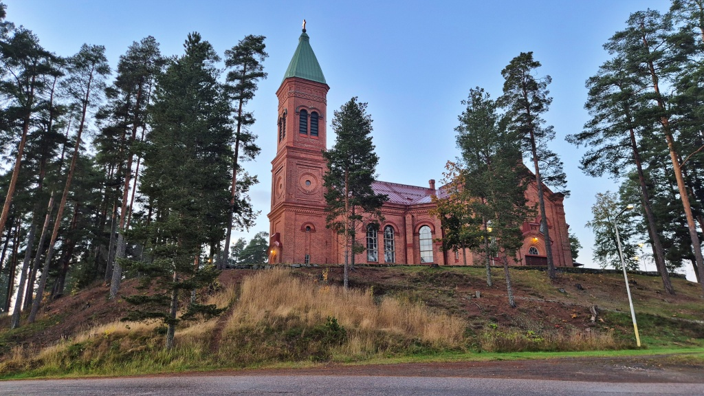

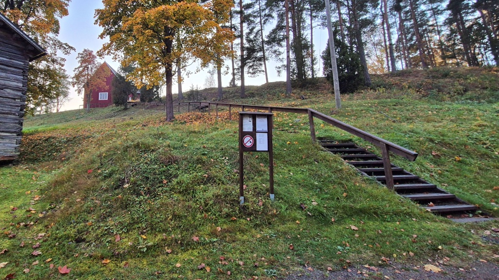

Egentligen gick det bra att köra ända till Piplala. Den sista biten ner till Högfors var det sedan ordentligt mörkt. Jag tog en kort tur genom staden. Jag skippade det gamla fabriksområdet och fotade bara kyrkan innan jag åkte vidare. Jag har varit i Högfors tidigare, men inte med Lilla Blue.

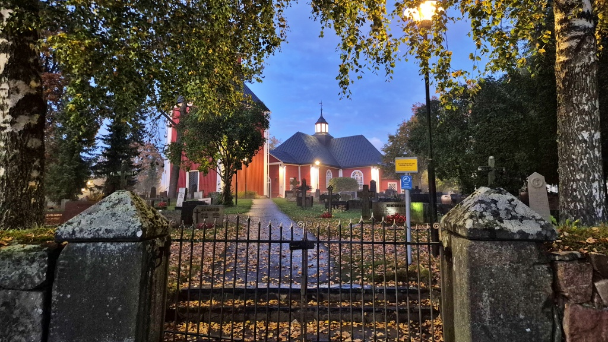

Från Högfors till avtaget mot nationalparken åker man längs den breda Björneborgsvägen. Sedan blev det en smärre chock att svänga in på den lilla och gropiga grusvägen för de sista kilometrarna. Smutsig strålkastare, tungt lastad mc och gropig väg med lösgrus i kolmörker är ju inte en situation som man känner sig alldeles hemma i. Nu började jag nog tvivla på att detta var en så bra idé.

## Liesjärvi nationalpark

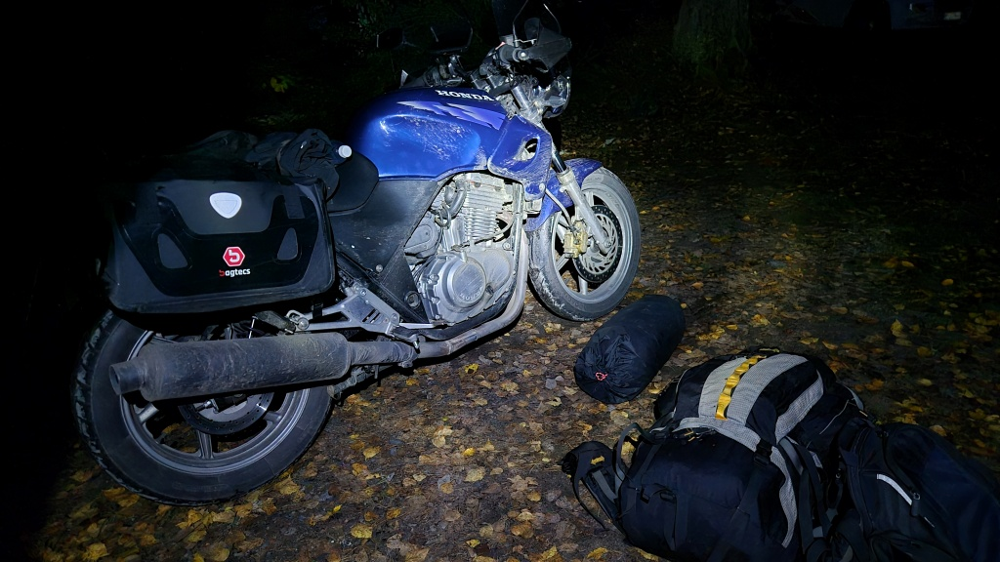

Framme vid parkeringsplatsen packade jag om och täckte över Lilla Blue med min medhavda presenning. Det var kolmörkt, så jag var helt beroende av min ficklampa. Jag lämnade hjälm och stövlar i sidoväskorna under presenningen, med förhoppningen att de inte skulle få fötter. Sedan bar det av drygt en kilometer längs hala spångar genom en tät och totalt mörk skog. Tältplatsen var i det närmaste full; där fanns säkert ett trettiotal tält eller fler. Jag gick två varv kring området innan jag hittade en plats att slå upp tältet på. Den var någorlunda plan, men låg alldeles för centralt för att jag skulle kunna räkna med ostörd nattsömn. Sedan var det dags för dagens lunch, middag och kvällsmål – grillad korv och en slurk rödvin.

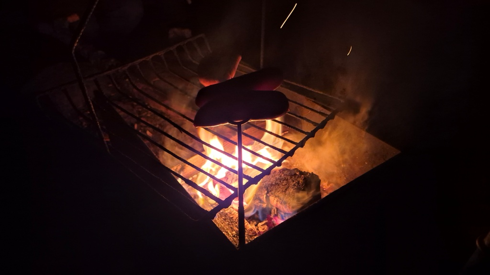

Nästa dag började med fint väder. Jag åt lite frukost medan jag packade ihop tältet. När jag lämnade tältområdet kl. 8.45 var jag nog bland de allra första. Jag packade det mesta på Lilla Blue och tog sedan en promenad över nationalparkens dragplåster, den smala åsen Kyynäränharju mitt mellan två sjöar.

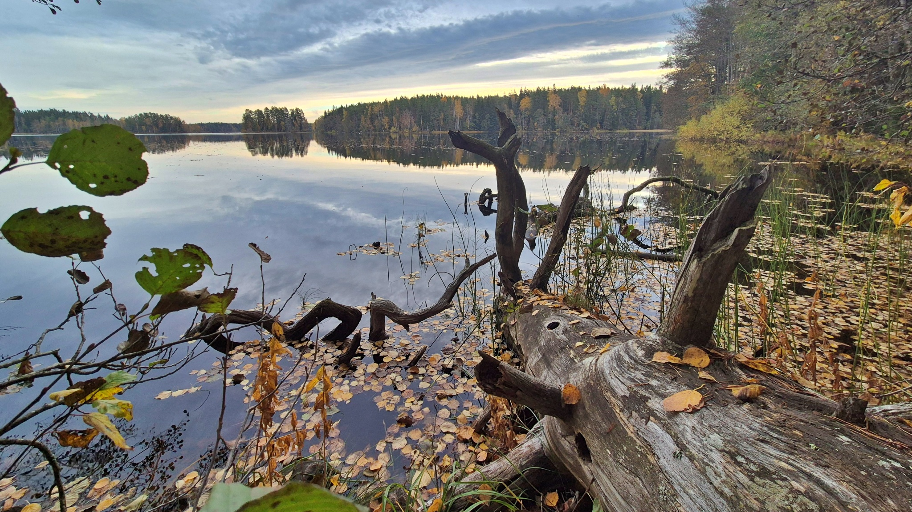

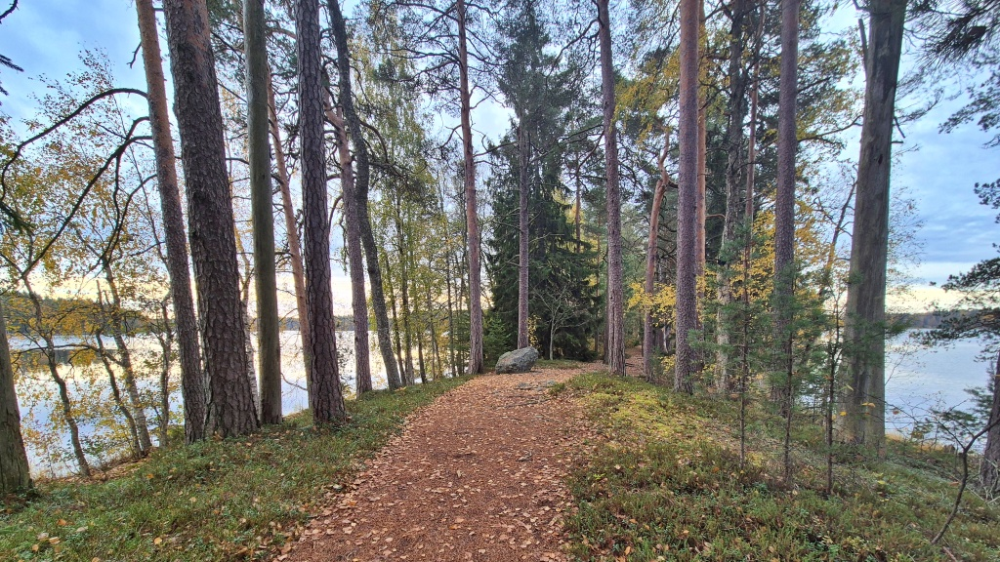

Så var det dags att ge sig av hemåt. Av med presenningen, sedan justerade jag det sista med packningen och så i väg. Vädret var ännu tjänligt, men regn hade utlovats till klockan 12.

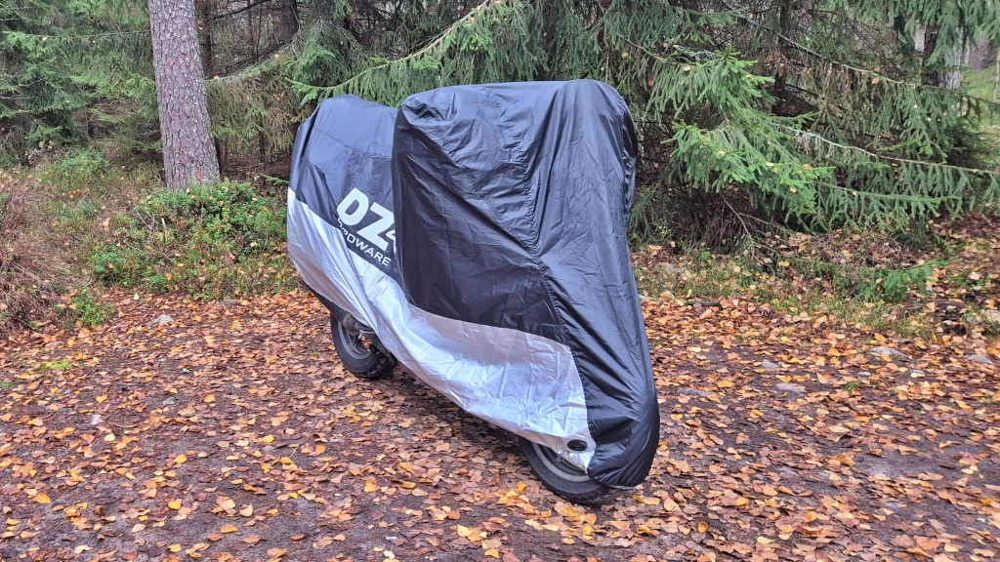

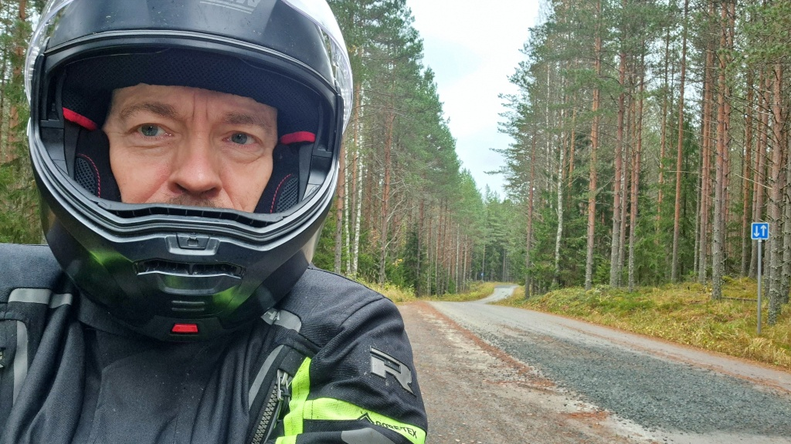

## Hemvägen

Jag måste ju bara åka igenom Sommarnäs (fi: Somerniemi, tidigare kommun men sedan 1977 en del av Somero), bara för namnets skull. Orten har fått sitt namn efter någon adelsman som ägde den lokala gården Palikais på 1600-talet.

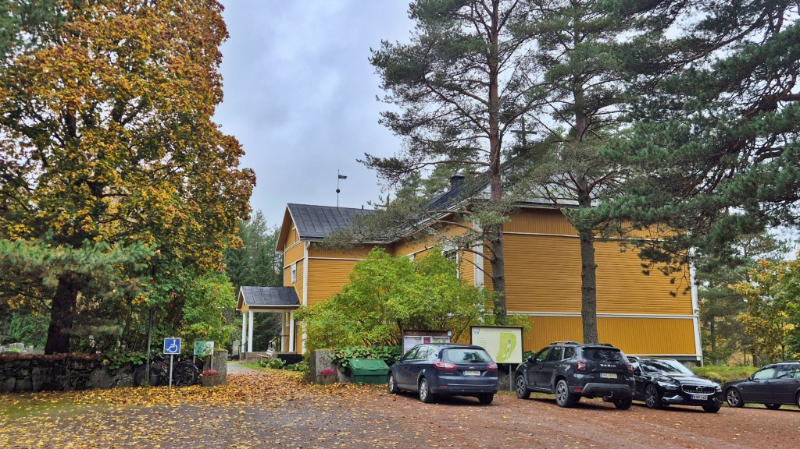

Medan vi åkte in mot Somero började himlen bli allt mörkare. Vi fotade kyrkan och tog sedan "bakvägen" ut i riktning mot Koskis på södra sidan av sjön Kirkkojärvi. Därefter fortsatte vi en kort bit längs grusvägar och kom till en bro som såg minst sagt suspekt ut. Stommen var av trä, men tydligen var brolocket inte längre i så bra skick, för man hade lagt ut grova plåtbitar som täckte största delen av körbanan. Trots det fanns det hål stora nog för ett motorcykeldäck att trilla igenom. Det var nog 3–4 meter ner till det strömmande vattnet. Nåja, det var bara att hoppas på det bästa och köra på.

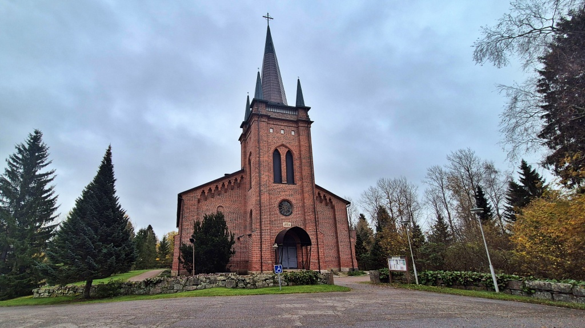

Precis efter bron började de första regndropparna falla. Trots att regnet strax upphörde igen beslöt jag mig för att hellre förekomma än förekommas och drog på mig regnställ och vinterhandskar.

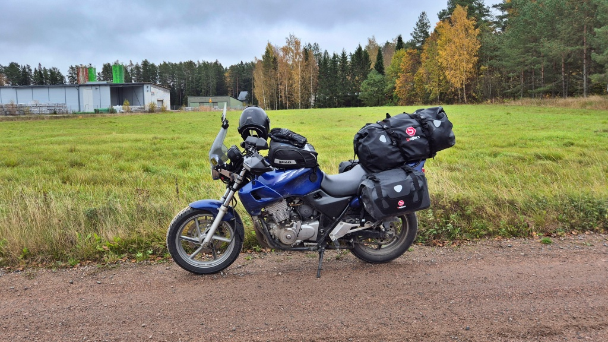

Ett kort tag höll regnet upp, men när vi kom in till Koskis (fi: Koski Tl) formligen öste det ner. "Tl" i kommunens finska namn betyder "Turun lääni" (sv: Åbo län), för att skilja orten från Koski Hl, alltså Hämeen lääni (sv: Tavastland län). Den senare orten heter numera Hämeenkoski (numera del av Hollola), men Koski Tl har behållit sitt suffix.

Koskis verkade vara ett fint ställe. Klockstapeln stod i ena änden av byn och den vackra kyrkan i den andra. Pemar å rinner genom byn och bildar i kyrkbyn en fors som har nyttjats till vattenkraft. Kvar finns ett museum och ett friluftsområde. Det hade säkert varit värt en promenad, om det inte hade varit för vädret.

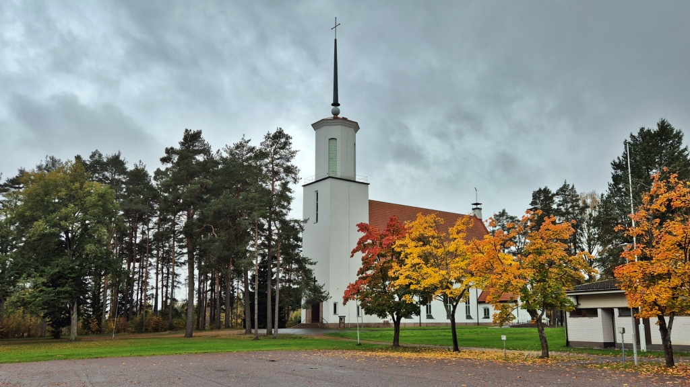

Vägen från Somero till Koskis var trevlig att köra, och det blev bara bättre ju längre söderut vi kom – kurvig väg med bra beläggning och varierande landskap att titta på. Vägen kallas [Tavastlands oxväg](https://sv.wikipedia.org/wiki/Tavastlands_oxv%C3%A4g) (fi: Hämeen härkätie) och har använts åtminstone sedan 1200-talet. Trots regnet var det en riktig njutning att köra. Det var inte så blött att det hade bildats stora pölar, så det var inga större bekymmer med däckens väggrepp.

Snart var vi i S:t Mårtens (fi: Marttila). Orten liknade på många sätt Koskis: liten och ganska mysig.

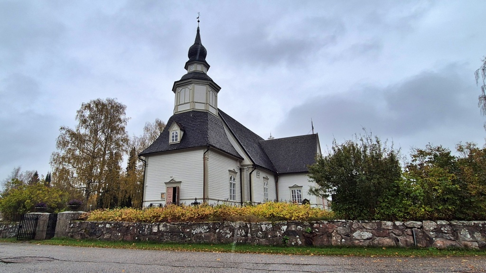

Vi följde den böljande Oxvägen ännu en bit mot sydväst, till Tarvasjoki (tidigare kommun, sedan 2015 en del av Lundo). Eftersom Tarvasjoki alltså är en del av Lundo (fi: Lieto) kan vi också kryssa av den kommunen som besökt. Vi får besöka Lundo centrum vid ett annat tillfälle, för nu var det dags att lämna Oxvägen och svänga av norrut.

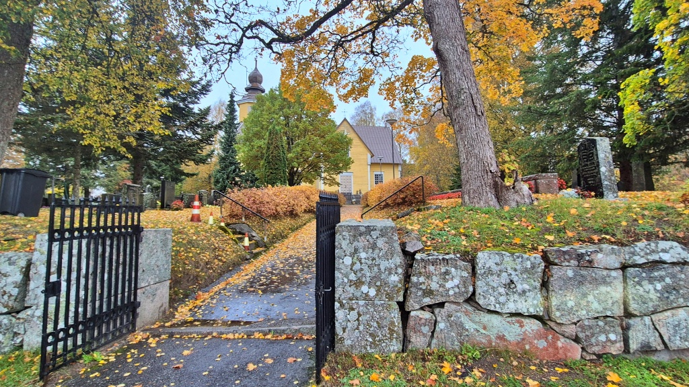

Första stoppet på vägen var Aura kyrkby, som ligger en bit söder om centrum, alldeles invid gränsen mot nuvarande Lundo. Sedan följde vi Aura å uppströms mot kommuncentrum. Vägarna fortsatte lika trevligt som tidigare, och nu höll det upp lite mellan skurarna.

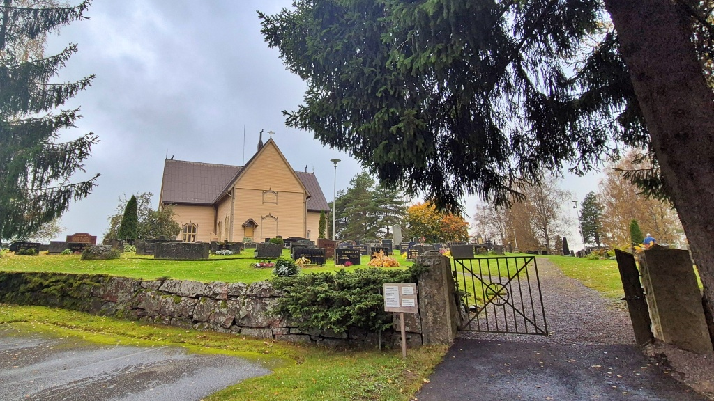

Aura är ingen stor kommun. Precis norr om centrum åker man in i Pöytis (fi: Pöytyä) kommun. Vi följde fortfarande den smala och kringliga vägen längs Aura å, istället för att ta den parallellt löpande väg 41. Centrum av Pöytis utgörs av byn Riihikoski, medan Pöytis kyrkby ligger 5 km norrut längs ån. Ovanför kyrkdörren hänger en skylt med texten "Gud till ära under konung Gustaf IV Adolfs andra regeringsår 1793 är denna kyrka byggd" på svenska, trots att kommunen idag är enspråkigt finsk.

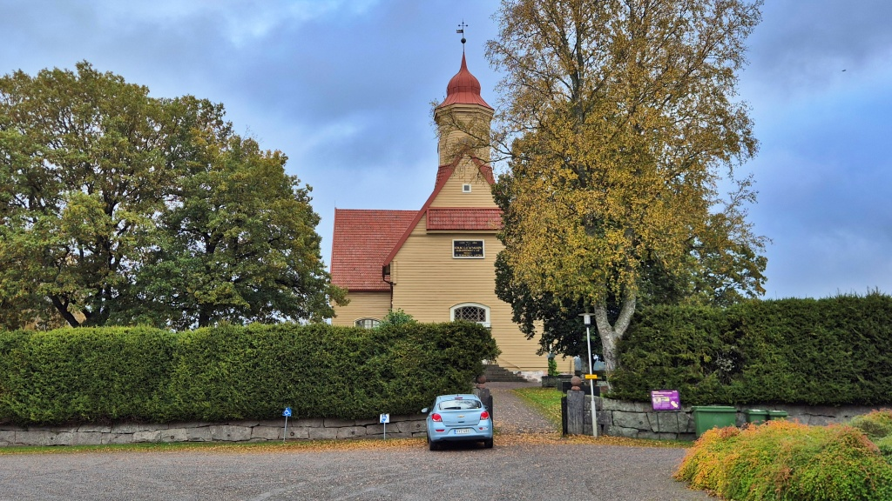

Vi åkte vidare längs Aura ås lopp. När vi kom till Oripääs centrum var ån knappt mer än ett stort dike. Aura ås källa ligger faktiskt bara en kort bit norr om centrum. Oripää centrum var inget stort ställe. Kyrkan låg nästan lite isolerat eftersom den låg på andra sidan stora vägen.

Vi har faktiskt åkt genom Oripää kommun en gång tidigare, men då bara längs väg 213 genom byn Juvankoski, en märklig exklav till Oripää som ligger inklämd mellan Säkylä och Loimaa.

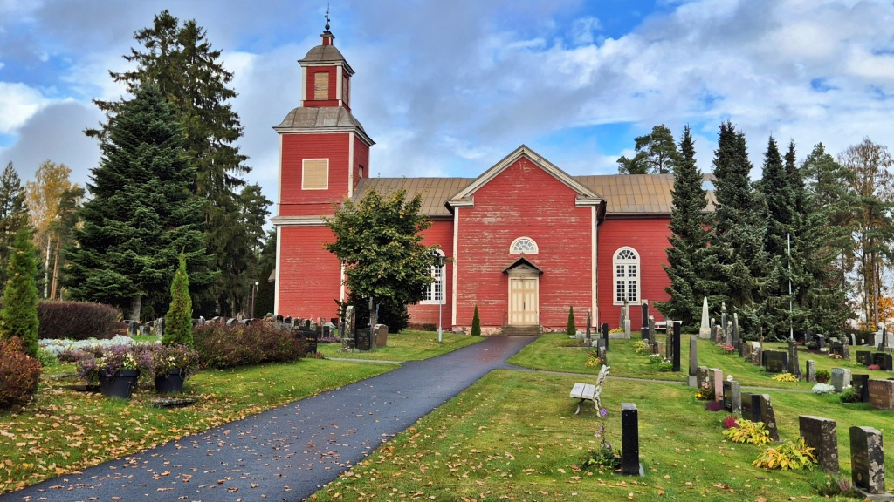

Därefter var vi tvungna att bege oss ut på stora vägen en kort bit. Efter en stund vek jag av mot byn Virttaa. Förut hette byn Virtsajoki, ungefär "pissdiket", så trots att det är ett tämligen fult namn är det väl bättre än förr. Byn är däremot riktigt gemytlig. Man har gjort om vägen genom mitten av byn till en enfilig gata med cykel- och gångvägar på sidorna. Tanken är att ge plats åt alla trafikanter. Samma lösning fanns också i Luopiois.

Virttaa hörde förut till Alastaro kommun, som sedan 2009 är en del av Loimaa stad. Byn hyser också den kända motorbanan Alastaro Circuit. Trots att det var nära körde vi förbi den här gången. [Senast vi körde genom Alastaro](../2024-06-09-helsingfors/#dag-2-hemåt-igen) upphörde regnet precis där, men i dag fortsatte de spridda skurarna ännu en bit norrut.

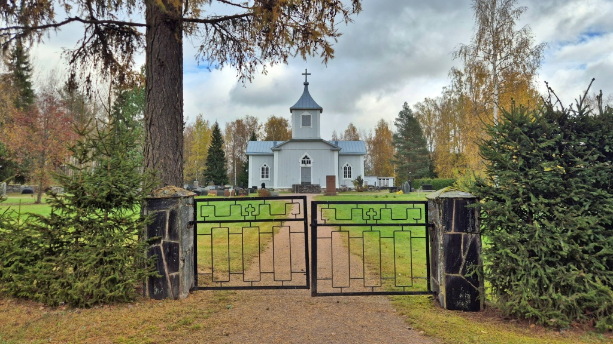

För att inte behöva köra hela tiden längs stora vägen svängde vi snart av igen, den här gången österut till Vambula (fi: Vampula, tidigare kommun, sedan 2009 en del av Vittis (fi: Huittinen)). Vi följde Loimijoki å en bit innan det var dags att åka ut på stora vägen norrut igen.

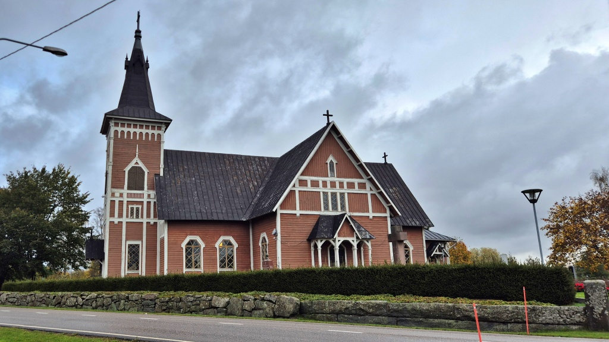

Nu blev det 30 km, först längs väg 41 upp till Vittis och sedan längs väg 12 vidare norrut. Landsvägskörning en regnig dag suger. Trafiken är tillräckligt tät för att man hela tiden ska ha bilar framför sig, och de drar upp ett moln av smutsiga vattendroppar som hamnar på visiret och överallt på motorcykeln och kläderna. Försöker man köra långsammare kör någon snart om, och så är man där igen. Även den mötande trafiken bidrar till att det yr smutsigt vatten. Därför undviker jag i mån av möjlighet tätt trafikerade vägar sådana här regniga dagar. Visserligen var vädret aningen bättre nu; mellan varven sken till och med solen en stund, men sedan kom det en regnskur igen. Vägarna torkar väldigt långsamt på hösten.

Först en bit norr om Vittis kunde jag vika av från stora vägen i riktning mot Kiikka. Kiikka kommun gick år 1981 samman med Keikyä kommun och bildade kommunen Äetsä. Äetsä gick i sin tur samman med Vammala och Mouhijärvi och bildade Sastamala stad år 2009.

I Kiikka ligger butiken Sale tvärs över vägen från kyrkan. Jag köpte lite vatten och en smörgås, stuvade undan grejerna och fortsatte norrut.

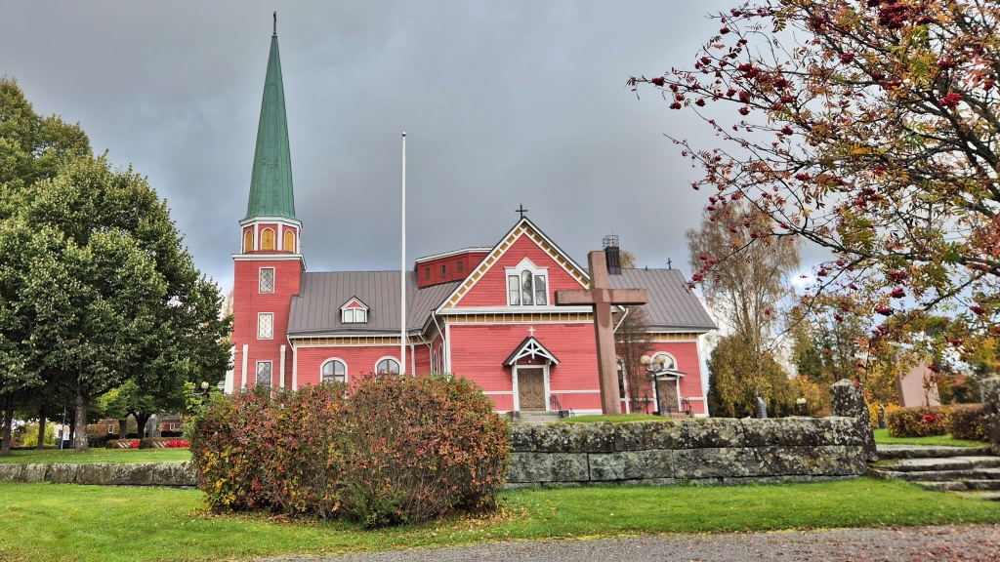

Nu var vägen norrut inte längre så tätt trafikerad, inget större problem med yrande smutsvatten längre. Jag tog i varje fall av på en liten omväg genom byn Kikois (fi: Kiikoinen). Kikois gick upp i Sastamala stad år 2013. Precis som Äetsä tillhörde Kikois tidigare till Satakunda, medan Vammala (och senare Sastamala) hör till Birkaland, alltså kom dessa kommuner att byta landskap i samband med kommunsammanslagningen.

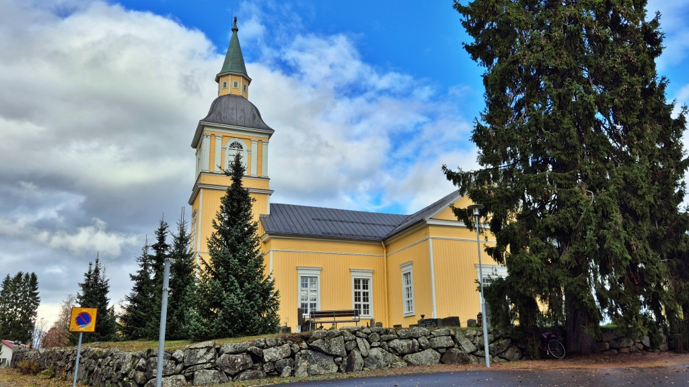

I Lavia (tidigare kommun, sedan 2015 en del av Björneborgs stad) tankade jag fullt. Ungefär här kom också den sista regnskuren. Ju längre norrut jag körde, desto mer klarnade det. Men samtidigt blev det också kallare och vägarna var fortfarande våta, så jag behöll regnstället på.

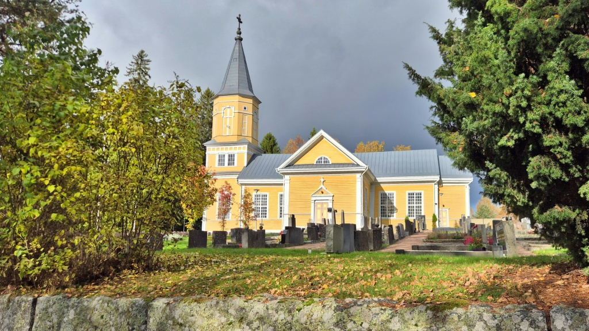

En kort tur genom Kankaanpää centrum, via kyrkan. Sedan via Honkajoki (tidigare kommun, sedan 2021 en del av Kankaanpää).

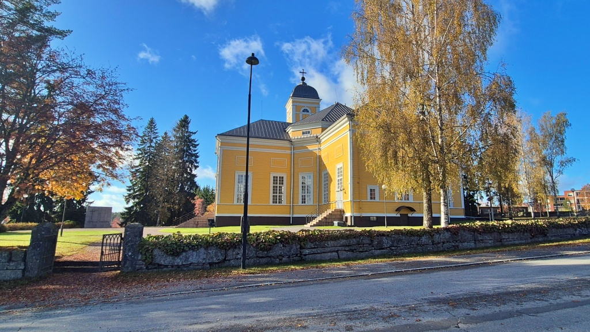

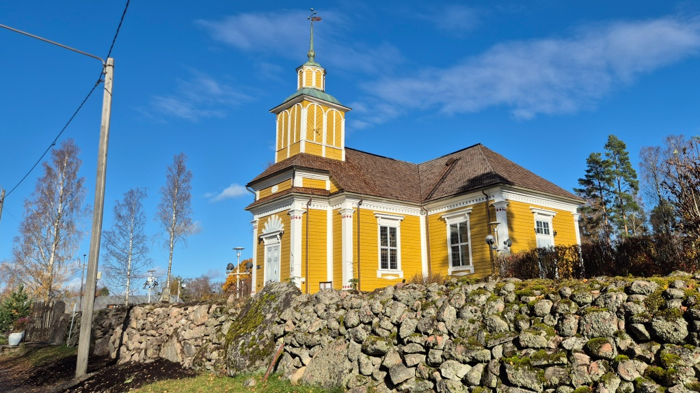

Mitt emellan Honkajoki och Storå (fi: Isojoki) fick jag nog av regnstället. Jag körde in på en liten skogsväg, tog av mig regnkläderna och tog en liten fikapaus. Vädret hade faktiskt blivit rejält kyligare. Trots att jag satt i solen med min vinterfodrade mc-jacka kändes det inte längre varmt. Kanske hade hösten precis anlänt med den blåsande nordanvinden. I stället för regnstället tog jag på mig fleecen och ställde handtagsvärmarna på vinterläge. Lite svalt var det, men det gick. Jag hade också kunnat dra på mig vinterfodret till körbyxorna, men tyckte inte att det var värt besväret då.

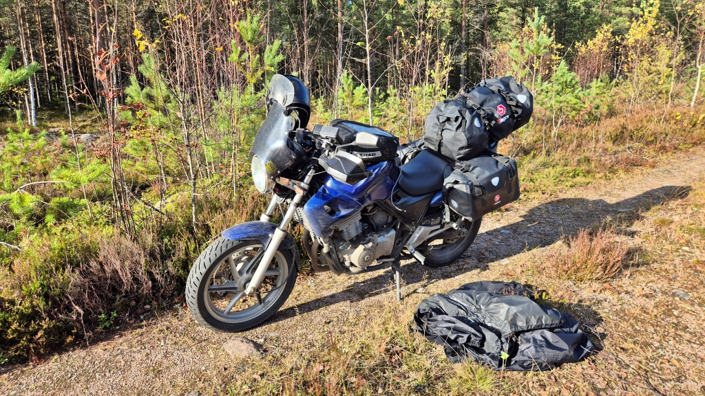

I Storå steg jag av hojen för en sista bensträckare. Eller framför allt för att fotografera vad som beskrivs som "världens största staty av en potatisskalare". Det kan jag tro, men jag har lite svårt att se att det skulle finnas någon större konkurrens.

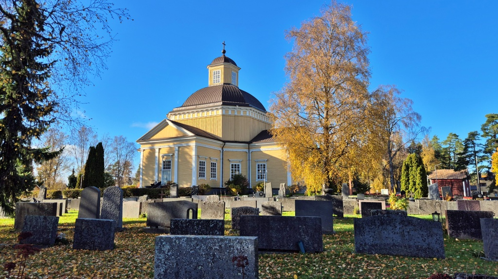

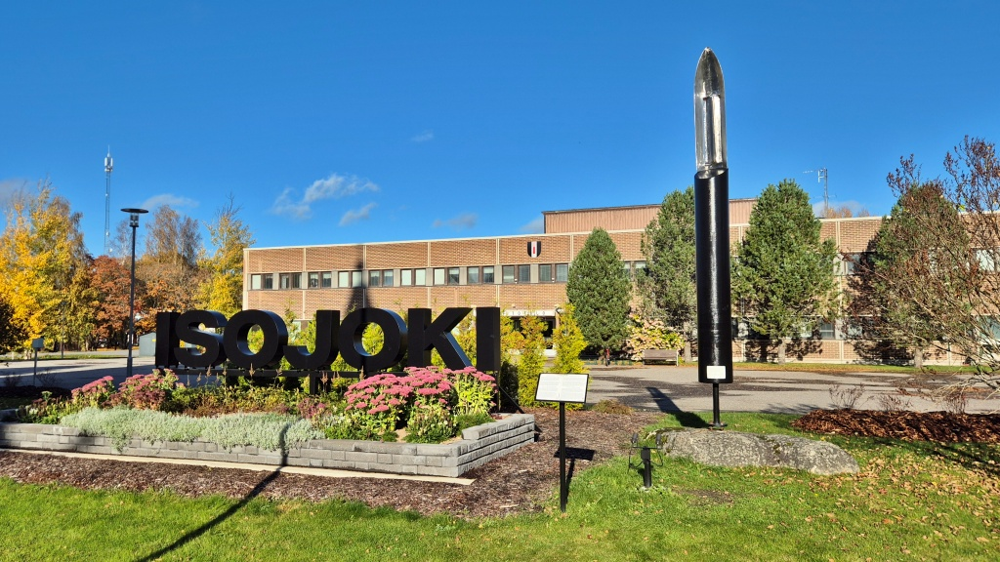

Sista etappen gick via Bötom (fi: Karijoki), Mörtmark (fi: Myrkky) och sedan ut till riksväg 8 vid "Tomaten" i Närpes.

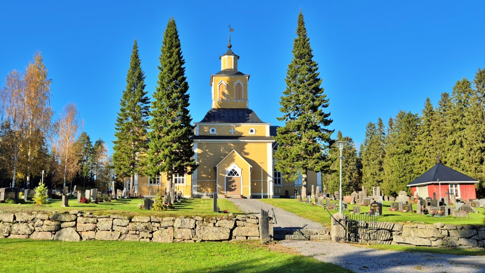

Vi anlände hem kl. 17. Ännu en gång får man vara tacksam över att komma hem utan missöden, men med några erfarenheter rikare.

## Reserutt

Jag skrev för två veckor sedan att [turen till Åbo](../2026-09-19-abo/) var säsongens sista långtur. Jag skrev också att fjolårets 11 103 körda kilometer på en säsong är ett [rekord som knappast kommer att slås](../2026-09-20-30k-tillsammans/#säsong-2025). Så fel man kan ha.

Det var ju meningen att den här turen skulle bli ganska kort, men eftersom oktobervädret var så varmt blev den liksom längre. Första dagen åkte vi (nästan) raka spåret till Helvetinjärvi nationalpark, 220 km. Andra dagen fortsatte vi söderut och körde 290 km. Tredje dagen blev det en hyfsad dagsetapp på 440 km, så totalt blev det 950 km på tre dagar. Det måste ju ändå räknas som en långtur! Samtidigt körde vi också förbi fjolårssäsongens totalsiffra. I år har vi kört 11 106 km, alltså 3 km längre än i fjol. :smile: Hittills!

Lilla Blues mätare visar nu 99 918 km. En CB 500-mätare har bara fem siffror och en decimal, så det betyder att mätaren slår över till 00000,0 km efter ytterligare 82 km. Om inte vädret plötsligt slår om lär det nog bli av ännu i höst. Har jag måntro en sprillans ny hoj då? Eller kommer hojen automatiskt att falla i småbitar i äkta Kalle Anka-manér? Eller blir det en repris på Y2K – absolut ingenting ändras?

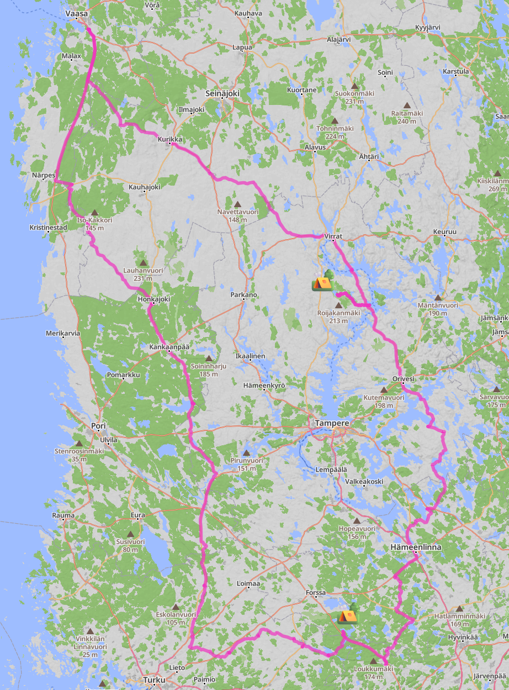

Mitt långsiktiga mål är att köra min mc, Lilla Blue, genom alla kommuner och städer i Finland. Under den här resan besökte vi sex nya kommuner. Vi har nu besökt 256 av Finlands 308 kommuner.

Nya kommuner under denna resa:

* Högfors (fi: Karkkila, Nyland)
* Koskis (fi: Koski Tl, Egentliga Finland)
* S:t Mårtens (fi: Marttila, Egentliga Finland)
* Lundo (fi: Lieto, Egentliga Finland)
* Aura (Egentliga Finland)
* Pöytis (fi: Pöytyä, Egentliga Finland)

Vi åkte också genom centrum av två orter vi tidigare bara susat förbi i utkanterna: Loppis (fi: Loppi) i Egentliga Tavastland och Oripää i Egentliga Finland.
