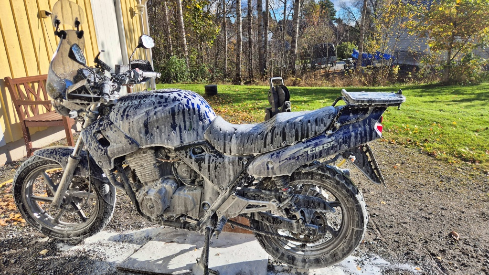
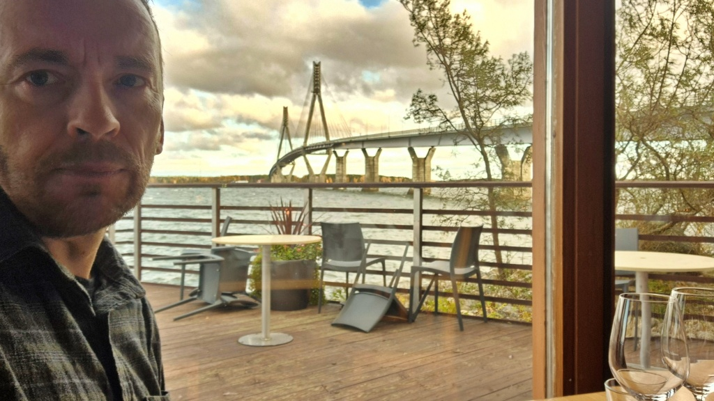
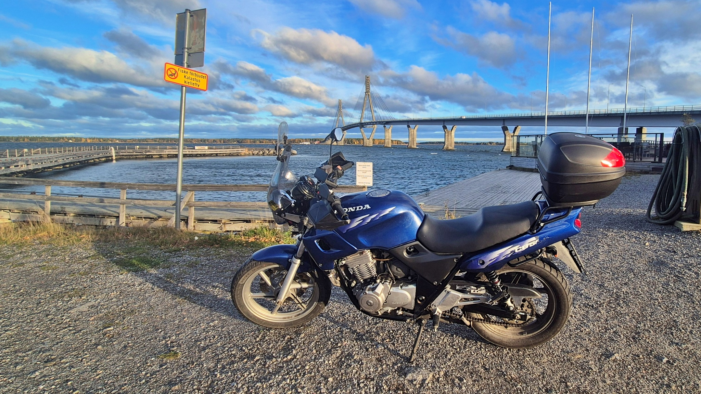
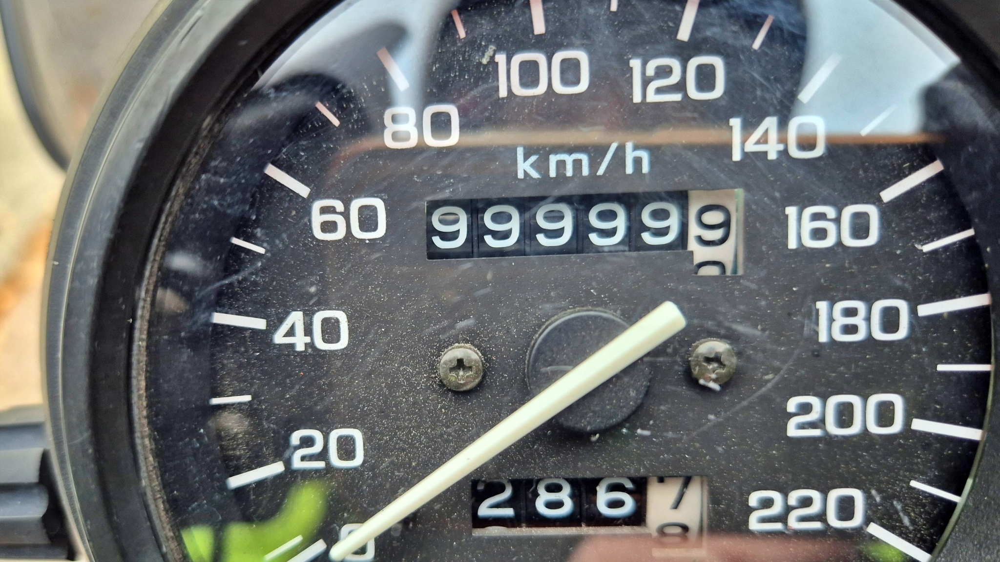
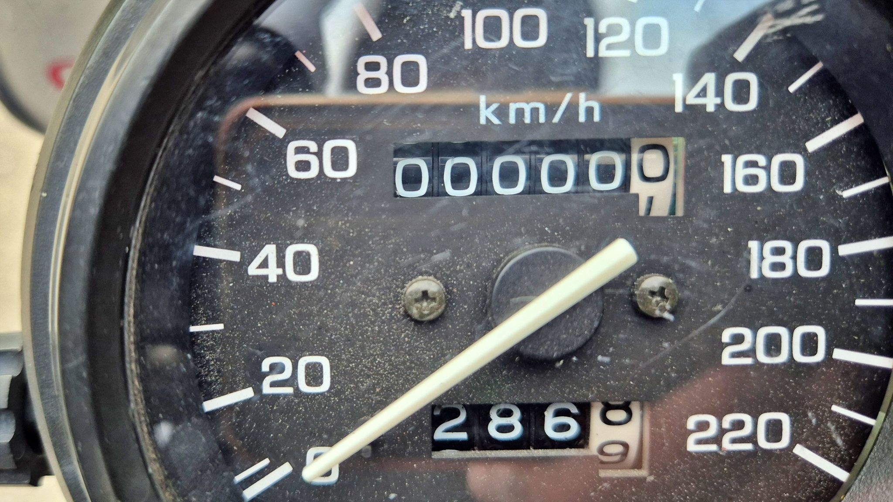
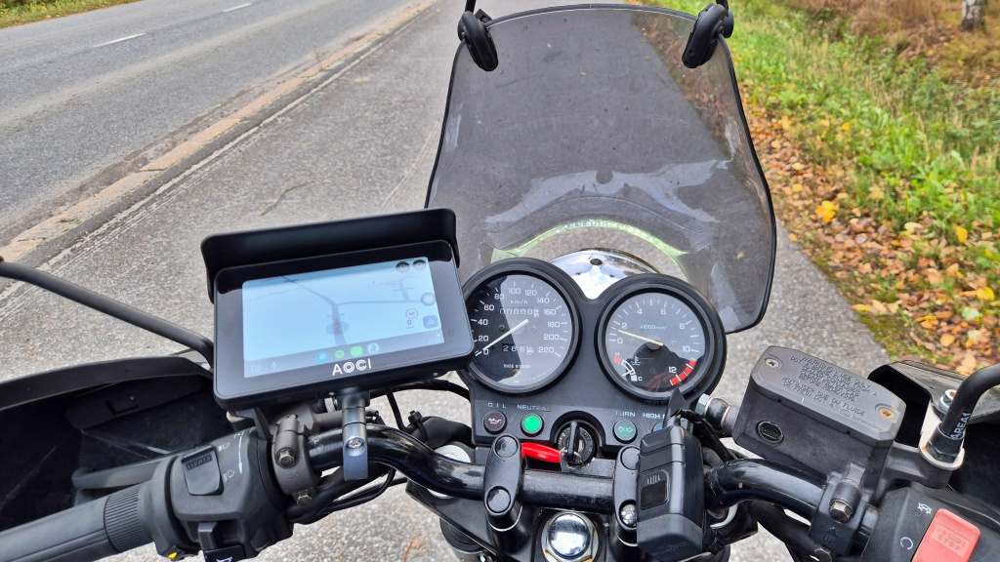

# Jag åkte ut på en gammal skrothög och kom hem igen med en knappt medkörd pärla?

Oj vad tiden går, eller åtminstone milen. I våras fyllde [Lilla Blue 90 000 km](../2026-05-13-levaneva-och-90k/#90-000-km). Nu var det sedan, lite oplanerat, dags för nästa milstolpe - 100 000 km. Men det fanns ett problem - mätaren går bara till 99999,9 km, och nu var vi alltså riktigt strax där. Vad händer när mätaren skall gå vidare från 99999,9? Min dotter gissade att hojen plötsligt och spektakulärt kommer att falla i tusen bitar, som i Kalle Anka. Själv trodde jag att alla Blues krämpor kommer att bota sig själva och jag skulle kunna åka hem med en i det närmaste okörd gammal pärla.

<!--more-->

Dagen bjöd på kring +5°C och hård byig vind, men solen tittade fram då och då. Jag hade tänkt spendera dagen hemma med diverse sysslor. Jag var faktiskt precis i färd med att ge Lilla Blue ett skumbad när jag fick kommendering att leverera något kvarglömt papper till min dotter, som var på tränaruppdrag i staden. Så det var bara att snabbt putsa skummet av hojen och pälsa på sig för en kort tur. Denna gång hade jag faktiskt en riktig orsak att ta hojen, för den ena bilen var borta och jag hade precis satt fast batteriladdaren i den andra bilen. För att inte störa CTeks algoritmer är det bäst att inte riva ur den på nytt innan den är klar.

En längre tur i dessa temperaturer kräver rejält med kläder, men nu skulle jag bara in till stan en sväng, så jag nöjde mig med att peta in vinterfordret i körbyxorna och så åkte jag i väg. Först när jag satt på hojen insåg jag hur nära 100k-gränsen vi var. Om jag förlängde dagens tur lite grann skulle vi kunna fira händelsen en relativt fin dag, istället för att bara notera att milstolpen passerade förbi på väg till jobbet. Så efter att jag hade levererat de glömda papprena styrde vi ut mot Replot-bron. Vindmätaren visade 16 m/s på bron, det drog och slet rejält i sidled när vi åkte över. Nu lämnade jag helt fräckt den blivande jubilaren ensam på den blåsiga parkeringsplatsen medan jag själv gick in på [Berny's](https://www.berny.fi) och beställde pizza.

Hård blåst och låg temperatur kylde av motorn snabbt. När jag försökte starta motorn igen efter en 45 minuter lång paus måste jag ge full choke, som om motorn hade varit helt kall. Men sedan puttrade vi iväg igen, över bron och genom Jungsund, Singsby, Karperö och Smedsby mot Gamla Vasa. Det var lite åt det kallare hållet, jag saknade nog långkalsonger och fleece som jag hade tagit på om jag hade vetat att vi skulle åka mer än 30 km.

Nu började det stora ögonblicket närma sig. Jag hoppades hinna fram till allén vid Korsholms kyrka, men det var för långt. Mätaren visade 99999,9 alldeles före järnvägsövergången i Runsor. Jag körde upp på gångvägen och puttrade sedan över järnvägsövergången med telefonen i handen för att föreviga det hela. Hade dotterns Kalle Anka-scenario förverkligats hade hojen flugit i tusen bitar precis på rälsen. Det skulle i själva verket ha varit ett trick värdigt självaste [Gråben (Wile E. Coyote)](https://sv.wikipedia.org/wiki/Gr%C3%A5ben_och_Hjulben) att sedan dessutom bli påkörd av tåget :smile:.

Vi kom i varje fall helskinnade över rälsen. Såvitt jag vet trillade inte en enda mutter av när mätaren slog om till noll. Det var nämligen vad som hände. Återstod bara att testa min teori om att alla Blues krämpor skulle läka sig själva. Till min besvikelse kunde jag konstatera att styrningen fortfarande har ett hack, kedjan fortfarande rasslar och att motorn inte går helt jämnt under 4000 rpm. Så det blev nog att köra de sista kilometrarna hem på samma gamla skrothög som förut. Tack och lov har jag de flesta delarna beställda, bara att börja meka.

