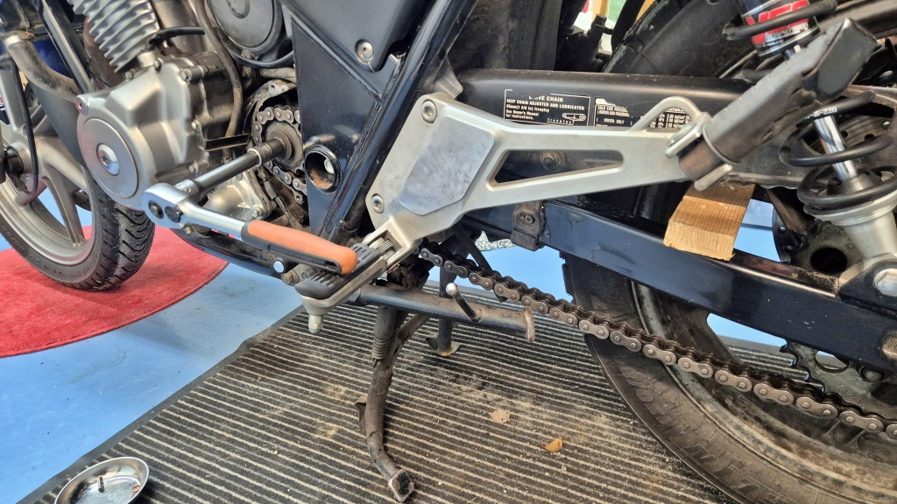
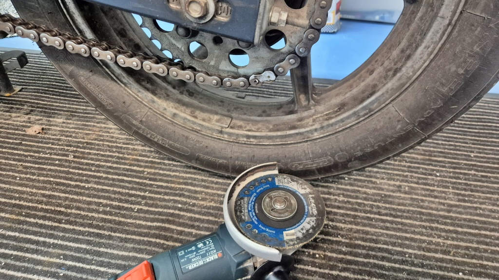
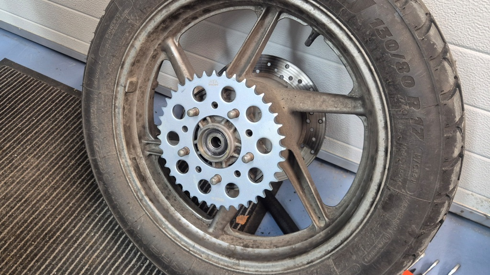
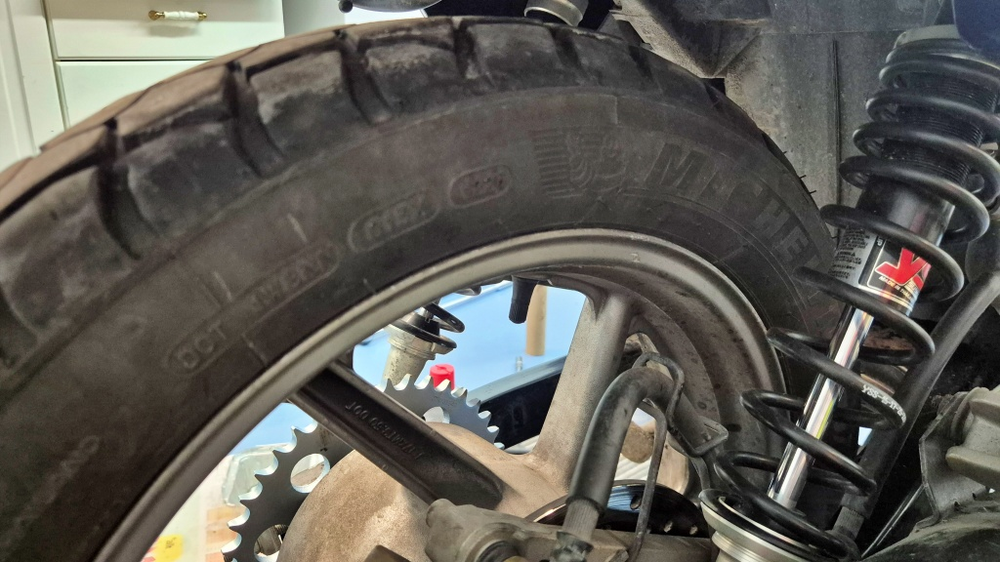
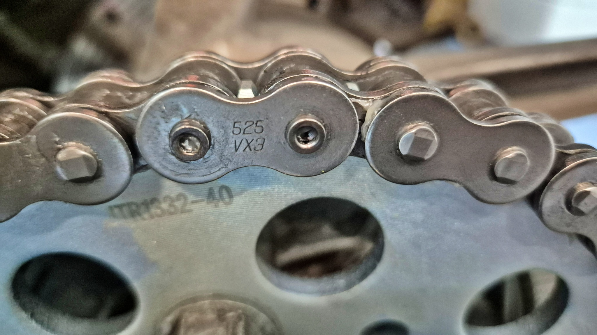
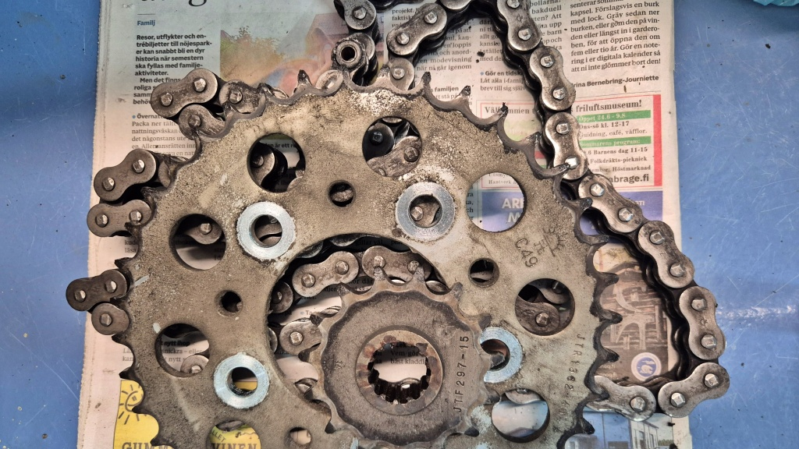
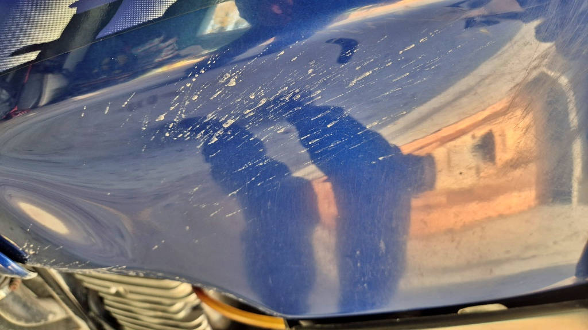

# Bytt drivpaket igen

Det känns nästan som det var i förrgår som jag [senast bytte drivpaket](../2025-07-17-drivechain/). Ett drygt år och 15 485 km senare är jag tvungen att byta på nytt. Det skramlar och rasslar, några av länkarna i kedjan är ganska styva om än inte helt stela.

<!--more-->

Först bort med skyddskåpan och sedan loss med framdrevet. Det är viktigt att göra detta så länge kedjan är på plats, så att man kan hålla fast framdrevet. En kloss mellan svängarmens båda sidor ser till att hålla bakhjulet stilla medan man vrider.

Före man ger sig på kedjan med kedjebrytarverktyget skall man fila av toppen av en länk. Det går lättast med humlan och en slipskiva. Nu råkade det sitta en kapskiva på, det fick duga. När toppen av niten är avfilad borde det bara vara att trycka ut den med kedjebrytarverktyget. Förutsatt att man har ett bra sådant set. Jag köpte en sats från Sealy ifjol. Förbaskad skit. Den är såtillvida felkonstruerad att det smala stiftet som skall trycka ut kedjans nit inte hålls stilla i sidled - vilket ledde till att stiftet brast. Jag lyckades till slut pressa ut niten med ett stift från en annan kedjebrytarsats (för vanliga cyklar). Jag kunde ju helt sonika ha kapat av kedjan.

Sedan av med bakhjulet och på med nytt drev. Bultarna skall spännas till 100 Nm så det är lite jobbigt att hålla stilla hjulet.

När jag monterade på bakhjulet igen och hjulet bara hängde på axeln märkte jag att det var ganska rejält i obalans. Hur jag än snurrade hjulet sökte det sig ganska fort tillbaka till läget med ventilen ca. fem över tolv. Blir kanske tvungen att lämna in hjulet för balansering, jag vill ännu ha två-tre tusen kilometer ur däcket innan jag byter.

Sedan på med nya kedjan. Så var det återigen dags att använda det usla Sealy-setet. När jag köpte setet stod det att detta är till för att dela kedjan och att nita kedjan. I instruktionerna anges sedan hjälpsamt att när man skall nita kedjan skall man använda ett speciellt nitstift (ingår ej). Tack så tusans! Nu pressade jag på ordentligt med en av de små kulor som ingick i satsen. Hoppas det räcker. Förra gången använde jag det smalaste stiftet (som nu alltså gick sönder) och det höll i varje fall ihop kedjan under hela dess livstid.

Det gamla drivpaketet såg inte speciellt slitet ut. Inga hajtänder ännu. Jag vet inte varför kedjan blev styv, jag har försökt smörja den regelbundet och se till att den inte hinner rosta. 15 500 km är inte speciellt mycket för en kedja på en ganska motorsvag mc. Den gamla kedjan var en JT men bytte nu till en lite dyrare D.I.D. Kanske den håller bättre mot korrosion? Eller kanske den håller hojens hela kvarvarande livstid, vem vet.

Som vanligt när jag skruvar går det ju inte direkt som på Strömsö. Denna gång alltså på grund av det där usla kedje-brytar-nitar-verktyget. Klockan var en bit över midnatt innan allt var ihop igen. Provturen ägde alltså rum först nästa kväll. Åtminstone var det stor skillnad i mängden skrammel, nu gick den rätt tyst och trevligt. Mängden vibrationer var också betydligt mindre, om än inte helt som det skall vara. Nu känns det mest som obalans i däcken - ganska givet. Men kanske vibrationerna jag känt faktiskt bara berodde/beror på två olika saker - styv drivkedja och obalanserat bakhjul. Kanske i kombination med lite nött styrlager. Själv har jag funderat på allt möjligt mycket krångligare som kamkedja ur synk och slitna ramlager. Kanske det inte behöver vara så krångligt?

Provturen skedde i "torrt" före, men torrt före i mitten på oktober betyder något annat än torrt på sommaren. Vägarna blir aldrig helt torra utan det skvätter och yr smutsigt vatten från de våta fläckar som ständigt ligger kvar på körbanan. Således blev Lilla Blue i behov av en ny tvätt efter bara 100 km körning.

