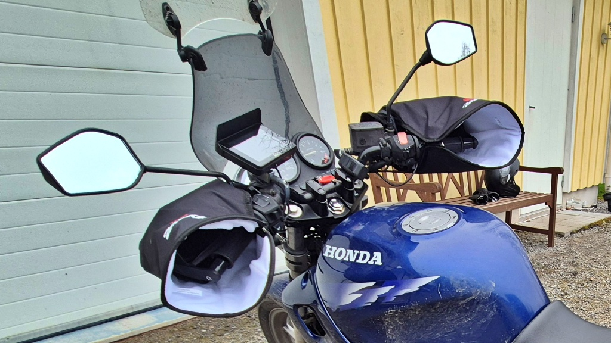
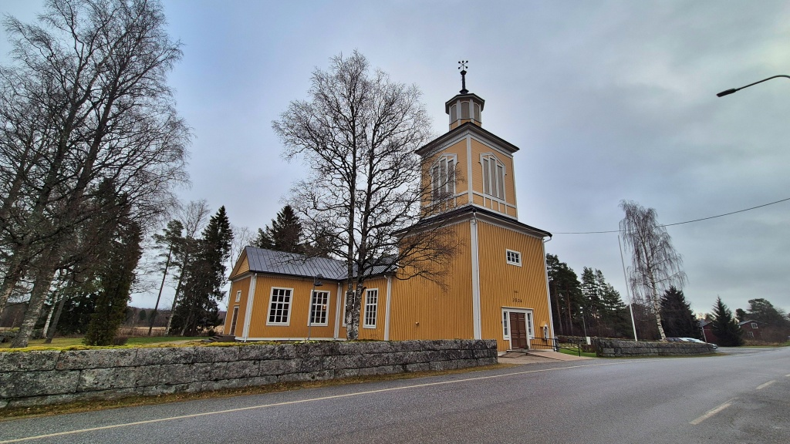
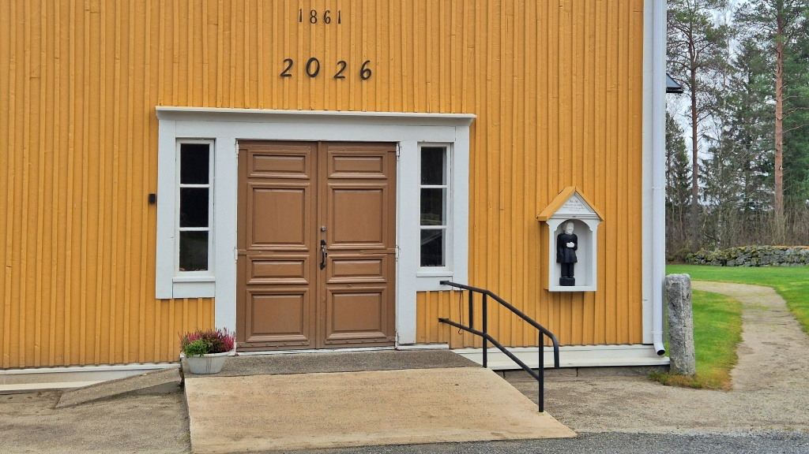
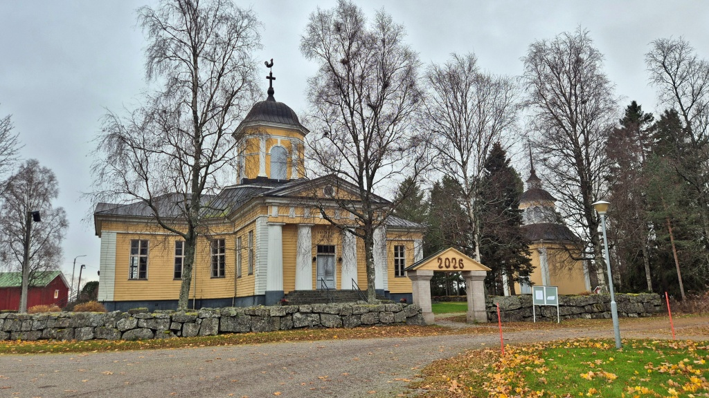
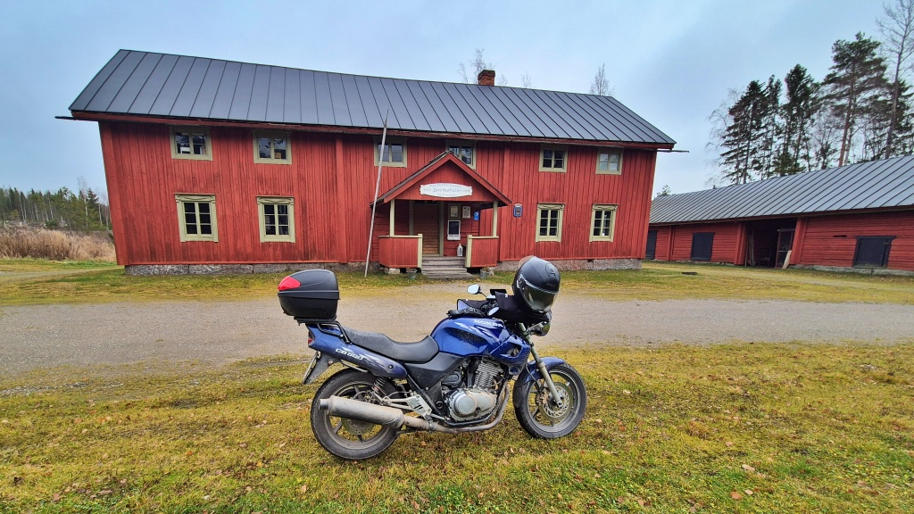
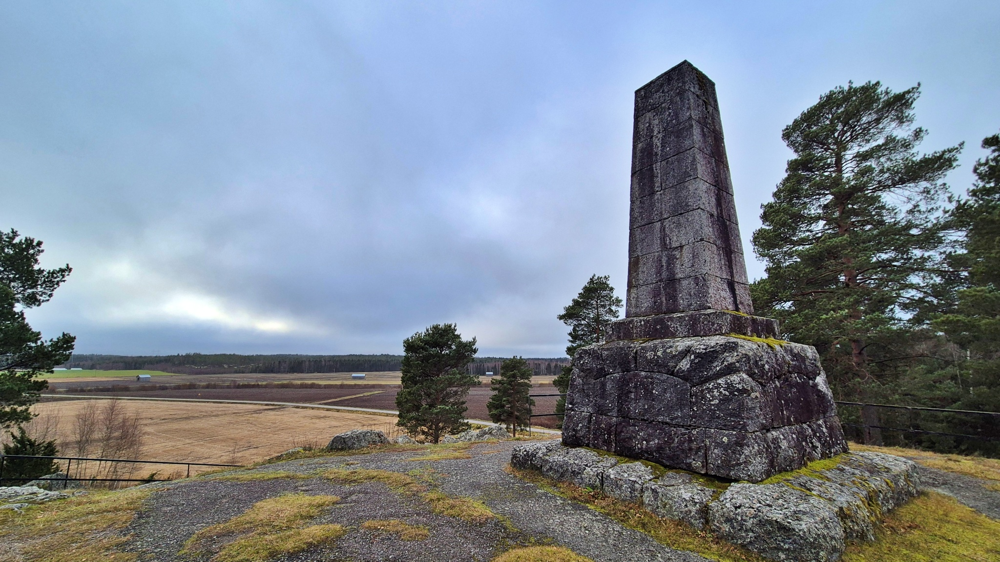
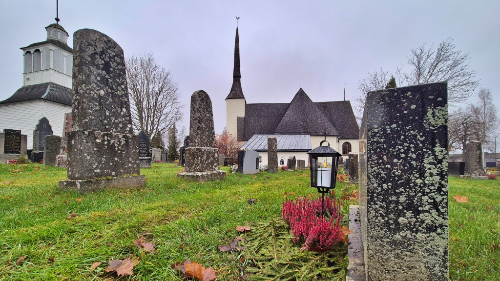
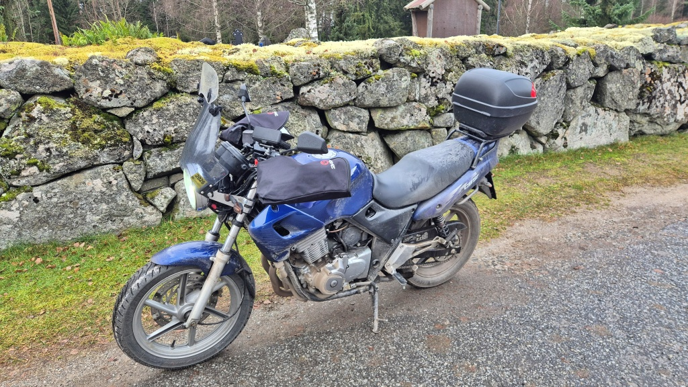
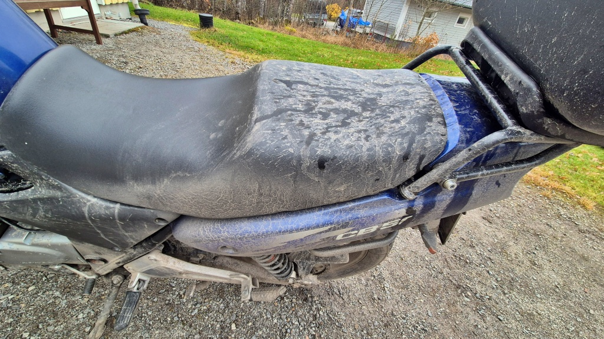

# Hösttur till Oravais Slagfält

Nu närmar sig nog slutet på körsäsongen - på riktigt. Dagarna är korta och vägarna torkar aldrig riktigt upp. Efter två veckors paus hade jag i varje fall lite abstinensbesvär med åkandet. I dag passade jag således på att åka sväng, fullt medveten om vilka utmaningar som väntade.

<!--more-->

Jag klantade mig för ett par veckor sedan när jag skulle borra en metallbit. Arbetsstycket slog ganska rejält i min vänstra tumme, med påföljd att nageln försvann och såret måste sys. Jag har haft ett stort paket kring tummen och således inte kunnat få på körhandskar och sånt. På fredagen togs i varje fall största delen av omslagen bort, så att det bara lämnade ett aningens tjockare slags plåster. Jag lyckades nu kränga på mig min största körhandske, även om det inte var alldeles bekvämt. Detta var alltså första gången på två veckor som jag över huvudtaget hade förutsättning att köra hoj.

Väderleksprognosen lovade +5° och växlande molnighet men uppehåll. Jag tror ändå att termometern höll sig precis under 5 hela dagen och den växlande molnigheten innebar i praktiken 3 minuter blekt solsken då att jag såg min skugga, resten av dagen var det tjocka moln. Och uppehållet visade sig innehålla en hel del duggregn, faktiskt.

Jag fick alltså ställa in mig på kallt och fuktigt. Jag var även mycket medveten om att vägarna den här tiden på året aldrig torkar upp, utan de får istället ett permanent lager av vattenblandad lera (från jordbruksmaskiner). Dessa var förutsättningarna, jag var beredd. Jag utrustade Lilla Blue med extra handskydd av textil kring handtagen (modell Hippo Hands, fast en billig kopia.) Tyvärr är de lite för små för att rymmas över de fula plast-handskydden jag alltid har på, men det gick att få dem att hållas fast. Nackdelen är att jag inte når blinkers-knappen, åtminstone inte med min skadade vänster tumme. Istället fick jag dra ut handen ur handskyddet varje gång jag ville manövrera blinkers. Under handskydden stekte naturligtvis också mina värmehandtag på, nivå 2/5 räckte bra.

Själv utrustade jag mig med tjockare körhuva under hjälmen, en extra krage, sex lager på överkroppen och fem på underkroppen. Det yttersta lagret var mitt regnsställ, som förutom att det skyddade mot fukt och kall vind också skyddade mina körkläder från det smutsiga vattnet som hela tiden yr omkring. Skidstrumpor och stickade sockor i körstövlarna fullbordade munderingen.

På det hela taget gick det bra att köra. Efter ett par timmar blev det lite kallt om fötterna, men i övrigt var det inte för kallt. Det gjorde lite ont i min skadade tumme, men den verkar ha klarat sig utan att såret börjat blöda igen, så jag räknar det som ett plus. Det största problemet är egentligen all utrustning som skall lirkas på och av - man blir inte sugen att ta en kaffepaus när man vet att man måste ha av de skitiga regnkläderna och sedan dra på dom igen. Och telefonen hade jag i körbyxornas ficka, så den är inte speciellt lätt att lirka fram under regnbyxorna - några fin foton förblev nog oknäppta på grund av det.

Rutten gick mestadels längs bekanta vägar. Via Toby till Golkas, sedan längs Kyro älv upp till Storkyro. Därifrån till Komossa, vidare längs en hal och mjuk grusväg till Alahärmä, sedan Voltas och Jeppo. En väg som jag faktiskt aldrig kört var att åka över bron över Nykarleby älv i Lassila och sedan längs Kyrkvägen tillbaks in till Jeppo.

Från Jeppo fortsatte jag genom Pensala till Oravais. Jag tog ett foto av kyrkan och åkte sedan ut till Furirbostället vid slagfältet.

[Slaget vid Oravais](https://sv.wikipedia.org/wiki/Slaget_vid_Oravais) den 14. september 1808 var den svenska armens sista riktiga försök att stoppa de framryckande ryssarna under [1808-1809 års krig](https://sv.wikipedia.org/wiki/Finska_kriget). Det var också det slag där det stupade flest svenska trupper och kan räknas som det slag som slutgiltigen avgjorde kriget. Ryssarna fortsatte efter detta upp längs Österbottniska kusten och sedan in i Sverige ända ner till Skellefteå. De marcherade också över isen och intog Umeå. De intagna områdena i nuvarande Sverige lämnades tillbaks, men Finland blev en del av Ryssland. Värt att hålla i minnet. För oss Finländare känns hotet österifrån återigen mera aktuellt än på länge.

I dag firas [allhelgonadagen](https://sv.wikipedia.org/wiki/Allhelgonadagen), till minne av de avlidna. Traditionen bjuder att man tänder ljus vid avlidna släktingars och vänners gravar. På hemvägen från Oravais passade jag på att besöka Vörå gravgård, där några av mina bortgångna släktingar är begravda.

Det blev 216 km den sista oktober i +4,5°C utetemperatur. Turen gick ungefär som förväntat. Kallt, vått och väldigt klottigt. Tummen värkte lite, men egentligen hade det gått över förväntan. Jag hade annat program på eftermiddagen, annars hade jag nog kunnat tänka mig en lite längre tur, gärna med en kort vanding eller så i mitten, för att värma upp kroppen lite. Men det blir nog svårt att hitta tid för flera turer detta år, även om vädret skulle fortsätta hålla sig på plus-sidan. Vi får väl se.

