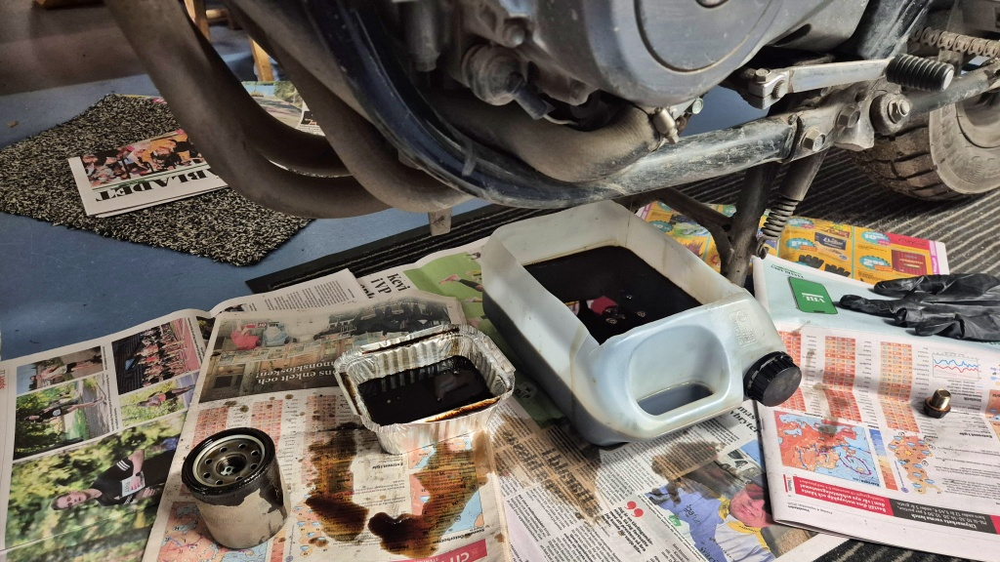
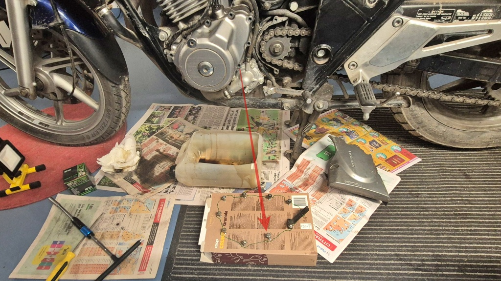
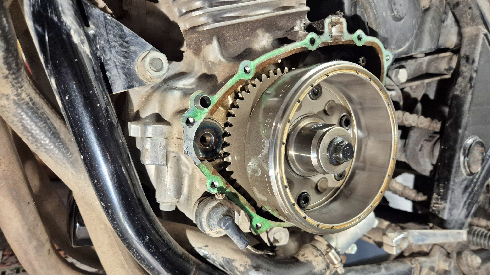
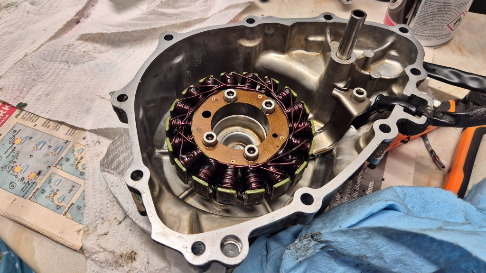
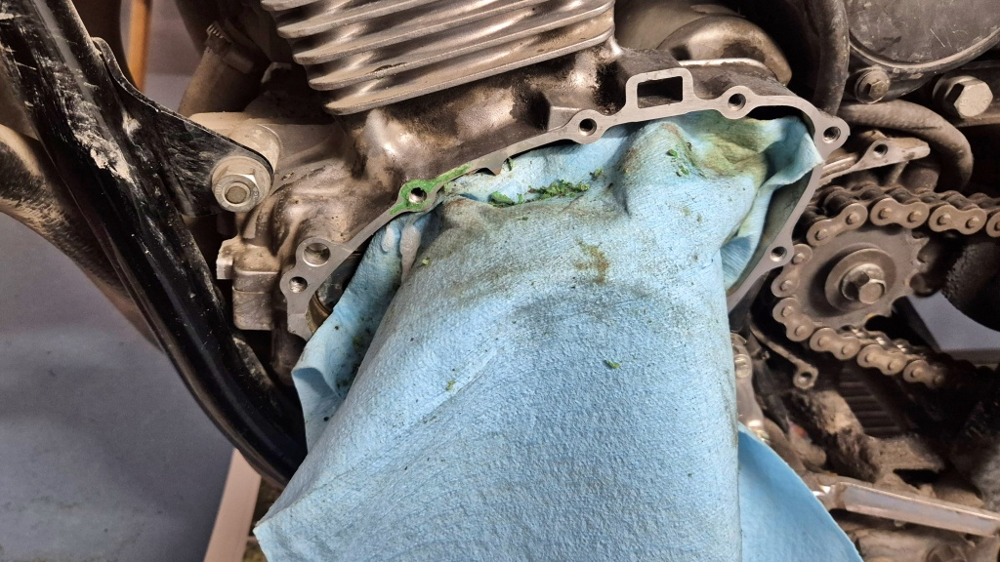

# Oljebyte och byte av packning till generatorkåpan

Dags att byta motorolja i Lilla Blue. Samtidigt beslöt jag att försöka åtgärda det lilla oljeläckaget kring generatorkåpan. Det är antagligen genomföringen kring generatorkabeln som släpper igenom lite olja. Det är inga märkbara mängder olja som läcker ut, men tillräckligt för att det ska bildas irriterande svart smuts kring generatorkabeln. När jag ändå ska tömma motorn på olja var det ju ett utmärkt tillfälle att fixa packningen också.

<!--more-->

Efter 11 500 km sedan det senaste oljebytet och med vintern på ingång var det dags att byta olja. Manualen rekommenderar oljebyte med 12 000 km mellanrum, så det var ändå dags. Jag åkte ut på en kort sväng för att värma upp oljan ordentligt. Jag trodde att föret var helt torrt, men tydligen var det ändå vått på vägen på något ställe. När jag kom tillbaka hade den nyss skinande rena Blue återigen stänk av smutsvatten här och där. Suck.

Ut med den gamla oljan medan motorn fortfarande var varm. Usch. När jag tittade på den illaluktande blandningen konstaterade jag att det kanske skulle vara helt okej att byta olja lite oftare än vad manualen rekommenderar. Jag såg åtminstone inga tecken på metall eller något annat än olja i blandningen. Jag bytte givetvis också oljefiltret och satte dit en ny kopparbricka till oljepluggen.

Sedan var det dags att ta itu med att byta packningen till generatorkåpan. Den nya packningen hade jag skaffat redan när jag [trodde att jag skulle behöva byta stator](../2025-05-23-charger/). I teorin borde ju detta vara ett ganska snabbt jobb, men som det oftast brukar vara går inga jobb särskilt snabbt för mig.

Jag var osäker på om bultarna hade olika dimensioner, så för att hålla reda på dem använde jag denna stiliga bulthållare gjord av ett cornflakespaket. Jag ritade konturen med den nya packningen som schablon.

Inga problem att få bort kåpan. Jag knackade lite försiktigt med en gummihammare, sedan lossnade den enkelt. Men sedan började problemen. Packningen satt ordentligt fast, både på motorblocket och på generatorkåpan. Jag testade att blöta den med Brakleen och aceton, men inget hjälpte. Den enda plastskrapan jag hittade blev snabbt utsliten, men packningsresterna satt stadigt kvar.

Det var helt enkelt bara att åka till Motonet och hämta packningslösare, "Gasket Remover". Och en plastskrapa. Återigen hade alltså ett litet och lätt jobb förvandlats till ett jobb som för det första inte var så litet och lätt och för det andra krävde nya verktyg.

När jag äntligen kom igång med skrapandet var det nästan läggdags redan. Själva kåpan gick ganska bra att rengöra. Jag sprejade på packningslösaren och lät den verka i 20 minuter. Sedan gick det att gnugga loss packningen. Det behövdes i alla fall två omgångar för att få bort alla rester.

Det var betydligt värre med motorblocket. Dels behövde jag ta en bit åt gången, eftersom jag var tvungen att täcka över de delar där jag inte ville att packningsrester skulle hamna. Dels var det riktigt krångligt att komma åt på vissa ställen. Så där satt jag halva natten på knä i skenet av en laddbar bygglampa och sniffade lösningsmedel i stället för att få min skönhetssömn.

Med alla skrapor utslitna och klockan en bra bit efter midnatt fick jag äntligen bort de sista packningsresterna. Sedan satte jag den nya packningen på plats. Jag lade lite packningstätning runt genomföringen för statorkabeln och monterade sedan tillbaka kåpan. Därefter monterade jag tillbaka de andra kåporna. Till sist var det äntligen dags att fylla på ny motorolja. Jag fyllde på 3,1 liter den här gången (annars brukar 3,05 l räcka, men eftersom generatorkåpan hade varit borttagen räknade jag med att jag hade lyckats tömma motorn bättre den här gången).

Sedan var det dags för nattvila.

Nästa morgon stank garaget fortfarande av lösningsmedel och gammal olja. Normalt sett sköter jag mitt dagjobb från hemmakontoret i garaget, men för att slippa stanken beslöt jag att åka in till det riktiga kontoret i stället. Eftersom väglaget var torrt och vädertjänsten lovade en solig och regnfri dag fick det bli en provtur med Lilla Blue samtidigt. Inga synliga oljeläckage så här långt, så packningsbytet verkar ha lyckats. Sedan vet jag inte om jag inbillar mig, men det känns som om växlarna går i lättare med ny olja. Det som inte var så lyckat var att väderlekstjänstens utlovade uppehåll förbyttes i ett rejält ösregn på hemvägen. Nu är Lilla Blue riktigt smutsig igen.